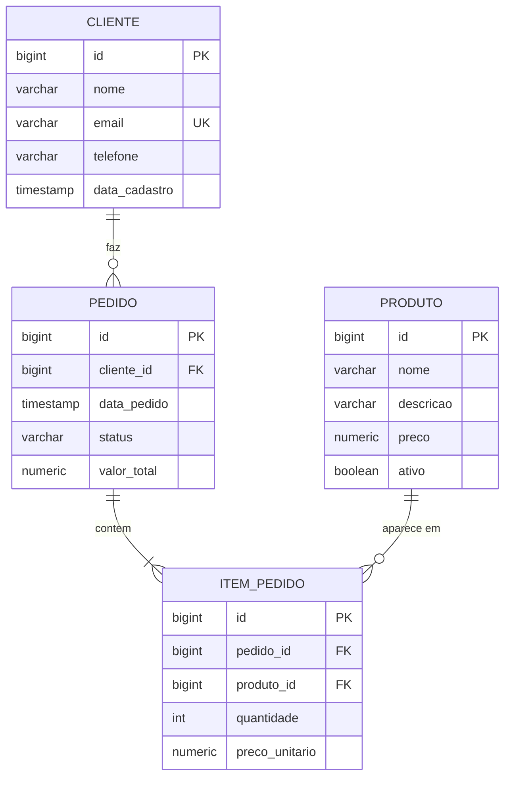

# Trabalho A2 — Otimização de Web Services

> O relatório técnico completo será escrito ao final do trabalho.

## Como executar o ambiente

### Pré-requisitos
- Java 21
- Docker com Docker Compose v2

O Maven não precisa estar instalado: o projeto usa o Maven Wrapper (`./mvnw`).

### 1. Configurar as variáveis
```bash
cp .env.example .env
```
Edite o `.env` e troque todas as senhas `troque-esta-senha`. O mesmo arquivo é lido pelo Docker Compose
e pela aplicação Spring Boot. Se as portas `5433` (PostgreSQL) ou `6379` (Redis) já estiverem em uso,
altere `POSTGRES_PORT` ou `REDIS_PORT`.

### 2. Subir o PostgreSQL e o Redis
```bash
docker compose up -d
docker compose ps        # aguarde postgres e redis ficarem "healthy"
```
As portas ficam publicadas somente em `127.0.0.1`.

### 3. Executar a API
```bash
./mvnw spring-boot:run
```

### 4. Verificar a saúde da aplicação
```bash
curl -s http://localhost:8080/actuator/health
```
O resultado esperado é `"status":"UP"`, com os componentes `db` e `redis` também `UP`.

### Recriar o banco do zero
Os scripts de `db/init/` só são executados quando o volume do PostgreSQL está vazio. Para recriar:
```bash
docker compose down -v
docker compose up -d
```

## Banco de dados e volume

### Modelo



- `pedido.status`: `PENDENTE`, `APROVADO` ou `CANCELADO`.
- `pedido.valor_total` = Σ(`quantidade` × `preco_unitario`) dos itens.
- `item_pedido.preco_unitario` guarda o preço praticado no pedido, que pode diferir do preço atual do produto.

### Scripts de inicialização (`db/init/`, executados em ordem pelo container)
| Script | Função |
|---|---|
| `01_usuario_app.sh` | Cria o usuário da aplicação, com permissão apenas de leitura e escrita de dados (sem DDL). |
| `02_schema.sql` | Cria as tabelas, as restrições e o índice `idx_item_pedido_pedido`. |
| `03_dados.sql` | Popula o banco de forma reproduzível (`setseed(0.42)`, data de referência fixa). |

### Volume gerado
| Tabela | Linhas | Tamanho total |
|---|---:|---:|
| cliente | 10.000 | 1,9 MB |
| produto | 1.000 (901 ativos) | 200 kB |
| pedido | 100.000 | 9,3 MB |
| item_pedido | 299.702 | 30 MB |

- 1 a 5 itens por pedido (média 3).
- Pedidos por cliente: mediana 9 e máximo 225 (distribuição desigual de propósito, para o experimento de índices).
- Status: ~60% aprovados, ~25% pendentes, ~15% cancelados.
- A carga leva cerca de 9 s. Os volumes podem ser ajustados nas variáveis `\set` no topo de `03_dados.sql`.

Índices existentes após a carga: as chaves primárias, `cliente.email` (UNIQUE) e `idx_item_pedido_pedido`.
Não há índice em `pedido.cliente_id` nem em `pedido.data_pedido`: essa ausência é o ponto de partida do
experimento de índices.

**Limitação conhecida:** as datas de pedido e de cadastro do cliente foram sorteadas de forma independente,
então alguns pedidos têm data anterior ao cadastro do cliente. Pela mesma razão, um pedido gerado pode ter
o mesmo produto em dois itens; a API não permite isso em pedidos novos. Nenhum dos dois casos afeta os
experimentos de desempenho.

### Validar os dados
```bash
set -a; . ./.env; set +a
PGPASSWORD=$APP_DB_PASSWORD psql -h 127.0.0.1 -p $POSTGRES_PORT -U $APP_DB_USER -d $POSTGRES_DB \
  -f db/validacao_dados.sql > resultados/volume-dados.txt
```
O script mostra as contagens, as distribuições, as verificações de integridade (todas devem ser 0),
o checksum de reprodutibilidade e o tamanho das tabelas e dos índices. A saída da carga atual está em
[resultados/volume-dados.txt](resultados/volume-dados.txt).

## Endpoints

| Método | Rota | Resposta de sucesso |
|---|---|---|
| POST | `/api/clientes` | 201 + `Location` + `ClienteDTO` |
| GET | `/api/clientes/{id}` | 200 `ClienteDTO` |
| GET | `/api/clientes/{id}/pedidos?page=0&size=20` | 200 lista de `PedidoResumoDTO`, do mais recente para o mais antigo (`size` de 1 a 100) |
| POST | `/api/produtos` | 201 + `Location` + `ProdutoDTO` |
| GET | `/api/produtos/{id}/sem-cache` | 200 `ProdutoDTO`, sempre consultando o banco |
| GET | `/api/produtos/{id}/com-cache` | 200 `ProdutoDTO`, consultando o Redis primeiro |
| PUT | `/api/produtos/{id}` | 200 `ProdutoDTO` (nome, descrição, preço, ativo); invalida o cache do produto |
| POST | `/api/pedidos` | 201 + `Location` + `PedidoDTO` |
| GET | `/api/pedidos/{id}` | 200 `PedidoDTO` com cliente e itens |
| PATCH | `/api/pedidos/{id}/status` | 200 `PedidoDTO` |

Rotas de experimento (somente leitura, fora da API de negócio): `GET /api/experimentos/pedidos/{lazy, eager,
eager/{id}, join-fetch, nativa, resumo-lazy, resumo-eager}?limite=1..1000`. Ver "Comparação LAZY e EAGER".

Exemplo de criação de pedido (o preço unitário não é enviado: o servidor copia o preço atual do produto):
```bash
curl -i -X POST http://localhost:8080/api/pedidos -H 'Content-Type: application/json' \
  -d '{"clienteId":545,"itens":[{"produtoId":10,"quantidade":2},{"produtoId":20,"quantidade":1}]}'
```

Toda resposta de `/api/**`, inclusive as de erro, traz o header `X-SQL-Count` com a quantidade de SQLs que a
requisição executou.

Os erros seguem o formato `ProblemDetail` (RFC 9457). Os erros de validação trazem a lista de campos inválidos:
```json
{"detail":"Dados de entrada inválidos","instance":"/api/pedidos","status":400,"title":"Bad Request",
 "erros":[{"campo":"itens[0].quantidade","mensagem":"deve ser maior que 0"}]}
```
Nenhuma resposta de erro expõe SQL, nomes de tabelas, stack traces ou classes internas. Erros inesperados
retornam 500 com uma mensagem genérica, e o detalhe fica só no log do servidor.

A coleção [postman/A2.postman_collection.json](postman/A2.postman_collection.json) tem os casos de sucesso
e de erro de cada recurso, com testes de status, e usa os IDs da base gerada (cliente 1, que tem muitos
pedidos, e cliente 545, típico).

## Regras de negócio

| # | Regra | Resposta quando violada |
|---|---|---|
| 1 | O pedido exige um cliente existente. | 404 |
| 2 | O pedido exige pelo menos um item. | 400 |
| 3 | A quantidade de cada item deve ser maior que zero (máximo 1000). | 400 |
| 4 | O produto deve existir, estar ativo e aparecer uma única vez no pedido. | 404 se não existe; 422 se inativo ou repetido |
| 5 | O preço unitário do item é o preço atual do produto, copiado pelo servidor. Reajustes posteriores não alteram pedidos já feitos. | — |
| 6 | `valorTotal` = Σ(quantidade × preço unitário), calculado pela entidade `Pedido`. | — |
| 7 | Todo pedido começa como PENDENTE. Só são válidas as transições PENDENTE → APROVADO e PENDENTE → CANCELADO. | 409 |
| 8 | O email do cliente é único, inclusive sob requisições simultâneas, porque o UNIQUE do banco também é tratado. | 409 |
| 9 | O preço do produto deve ser maior que zero, com no máximo 2 casas decimais. | 400 |

As regras ficam nos services e nas entidades, nunca nos controllers. A regra de status existe num único
lugar: `StatusPedido.podeMudarPara`, usada por `Pedido.alterarStatus`.

## Implementação de cache

### O que foi colocado em cache e por quê
O dado em cache é o detalhe do produto (`ProdutoDTO`: nome, descrição, preço e situação), lido por
`GET /api/produtos/{id}/com-cache`. Os critérios da seção 3.1 do enunciado:

| Critério | Avaliação |
|---|---|
| Frequência de acesso | Alta: é a leitura típica de um catálogo, consultada por todo cliente que navega. |
| Volatilidade | Média: o preço muda por reajuste, mas muito menos do que é lido. |
| Custo de recuperação | Baixo por consulta (busca pela chave primária), mas repetido a cada visualização. |
| Consequência de dado desatualizado | Só de exibição: o pedido sempre lê o preço do banco (ver abaixo). |
| Invalidação | Simples e precisa: um produto só muda pelo `PUT /api/produtos/{id}`, que invalida a chave dele. |

Estoque, saldo ou status do pedido ficaram fora do cache, porque têm volatilidade alta e servem de base
para decisões (na tabela da aula: "evitar cache como fonte de decisão").

### Tecnologia: Redis
O Redis é um armazenamento chave-valor em memória, externo à aplicação, com expiração nativa por chave
(TTL). Foi escolhido em vez do Caffeine porque fica fora da JVM: o cache sobrevive a reinícios da API, é
compartilhado se houver várias instâncias e pode ser inspecionado com `redis-cli` durante a demonstração.
O custo é uma ida à rede a cada consulta, que o experimento mede.

Integração pela abstração de cache do Spring (`@Cacheable` e `@CacheEvict`), no padrão da aula:

```java
// Cenário A: consulta o banco a cada chamada.
@Transactional(readOnly = true)
public ProdutoDTO buscarProduto(Long id) {
    return produtoRepository.buscarDTO(id).orElseThrow(() -> naoEncontrado(id));
}

// Cenário B: mesma consulta, mas o resultado fica no Redis até o TTL ou o próximo PUT.
@Cacheable(value = "produtos", key = "#id")
@Transactional(readOnly = true)
public ProdutoDTO buscarProdutoComCache(Long id) {
    return produtoRepository.buscarDTO(id).orElseThrow(() -> naoEncontrado(id));
}

@CacheEvict(value = "produtos", key = "#id")
@Transactional
public ProdutoDTO atualizar(Long id, ProdutoRequest request) { ... }
```

Configuração (`config/CacheConfig.java`):
- **TTL de 5 minutos** (`CACHE_TTL_PRODUTOS`), dentro da faixa de 1 a 5 min sugerida na aula para catálogo de preços.
- **Chave** `produtos::{id}` e **valor em JSON legível**, gravado por um serializador tipado que só reconstrói
  `ProdutoDTO`. O serializador genérico grava o nome da classe no valor, e quem conseguisse escrever no Redis
  poderia forçar a desserialização de classes arbitrárias.
- **Sem valores nulos**: produto inexistente responde 404 e nunca vai para o cache.
- **Invalidação depois do commit e síncrona**: a chave só é removida depois que a alteração é gravada no banco,
  e já foi removida quando o PUT responde. O Spring Data Redis 4.1 grava de forma assíncrona por padrão, por isso
  a gravação síncrona foi ligada explicitamente.
- **Proxy de cache por fora da transação**: um HIT responde sem abrir transação e sem ocupar conexão do pool do banco.
- **Tolerância a falha do Redis**: se o Redis cair, a API registra um aviso e consulta o banco (responde 200, não 500).
  O timeout de 500 ms limita esse custo: com o Redis parado, uma consulta com cache levou cerca de 1 s.

### Experimento obrigatório
Script reproduzível: [scripts/experimento-cache.sh](scripts/experimento-cache.sh). A saída completa está em
[resultados/cache/experimento-cache.txt](resultados/cache/experimento-cache.txt).

```bash
CACHE_TTL_PRODUTOS=10s SQL_LOG_LEVEL=info ./mvnw spring-boot:run   # TTL curto só para ver a expiração
scripts/experimento-cache.sh
```

| Passo | Requisição | X-SQL-Count | Estado no Redis | Resultado |
|---|---|---:|---|---|
| 1 | GET `/sem-cache` (2×) | 1 e 1 | chave não existe | sem cache, sempre consulta o banco |
| 2 | GET `/com-cache` | 1 | chave criada, TTL 10 s | MISS |
| 3 | GET `/com-cache` | **0** | chave existe | HIT, mesmo corpo do passo 2 |
| 4 | PUT preço 1419,87 → 1519,87 | 2 | **chave removida** | invalidação |
| 5 | GET `/com-cache` (2×) | 1 e 0 | chave recriada | MISS com o preço novo, depois HIT |
| 6 | aguardar o TTL, depois GET `/com-cache` | 1 | expirou sozinha | MISS por expiração |
| 7 | UPDATE direto no banco, depois GET `/com-cache` | 0 | chave antiga | **HIT com preço desatualizado** |
| 7 | POST `/api/pedidos` com o mesmo produto | — | — | preço cobrado é o do banco |
| 9 | GET `/com-cache` do produto 8 (preço 788,60) | 1 e 0 | `"preco":788.60` | escala do `BigDecimal` preservada |
| 10 | GET `/com-cache` de produto inexistente | 1 | nenhuma chave criada | 404, nada vai para o cache |
| 11 | `redis-cli MONITOR` durante um MISS e um HIT | 1 e 0 | — | comandos `GET`, `SET ... PX`, `GET` |

Nos passos 3 e 9, o corpo de `/com-cache` (HIT) é comparado **byte a byte** com o de `/sem-cache` (`cmp`) e é
idêntico. Isso confirma que a ida e a volta pelo Redis não alteram o JSON nem a escala dos preços.

Comandos que a aplicação envia ao Redis (passo 11; o `AUTH` nunca aparece no `MONITOR`):
```
"GET" "produtos::20"                                          <- MISS: chave não existe
"SET" "produtos::20" "{\"id\":20,...,\"preco\":1236.44,...}" "PX" "10000"   <- grava com TTL (10 s no experimento)
"GET" "produtos::20"                                          <- HIT: devolve o JSON, sem SQL
```

As métricas do Actuator (`/actuator/metrics/cache.gets?tag=result:hit` e `result:miss`) acompanham os
contadores a cada passo. O script restaura o preço original e remove o pedido que criou, então a base
continua idêntica à gerada.

Comparação sequencial (1 cliente, 200 produtos distintos, JVM aquecida):

| Cenário | Média | p50 | p95 | SQLs / 200 requisições |
|---|---:|---:|---:|---:|
| A — sem cache | 2,46 ms | 2,40 ms | 2,90 ms | 200 |
| B — com cache, MISS (cache vazio) | 3,66 ms | 3,50 ms | 4,30 ms | 200 |
| B — com cache, HIT (cache cheio) | 2,11 ms | 2,10 ms | 2,40 ms | **0** |

Esses números medem um único usuário. O comportamento sob carga (10 a 200 usuários simultâneos) entra nos
testes de desempenho com k6.

### Questões da seção 3.5
1. **Em quais situações o cache trouxe maior benefício?** Em leituras repetidas do mesmo produto (HIT): zero
   acesso ao banco e a menor latência e variação (p95 de 2,40 ms contra 2,90 ms). O ganho de tempo com um único
   usuário é pequeno, porque a consulta por chave primária já é barata. O ganho maior é tirar carga do banco e do
   pool de conexões, o que pesa sob concorrência.
2. **Como a volatilidade influenciou o TTL?** O preço tem volatilidade média e é invalidado a cada PUT, então o
   TTL não é o mecanismo principal de atualização. Ele é a proteção contra escritas que não passam pela API
   (passo 7). Com 5 minutos, um dado desatualizado dura no máximo isso, dentro do sugerido para catálogo de preços.
3. **Quais os riscos de dados desatualizados?** Exibir um preço que não é mais o vigente. Isso acontece se
   alguém alterar o banco por fora da API, se o Redis estiver fora do ar no momento da invalidação, ou numa corrida
   em que uma leitura antiga grava no cache logo depois do evict. Nos três casos o TTL limita a duração. O valor
   cobrado não é afetado, porque a criação de pedido lê o preço com `findAllById`, direto do banco (passo 7).
4. **O cache sempre melhorou o desempenho?** Não. No MISS ele é **mais lento** que o cenário sem cache (3,66 ms
   contra 2,46 ms), porque soma a consulta ao banco, o GET que não encontrou nada e o SET no Redis. Com o Redis fora
   do ar, cada consulta com cache passa a esperar o timeout. O cache só compensa quando a taxa de HIT é alta, ou
   seja, dados lidos muitas vezes entre duas alterações.

## Comparação LAZY e EAGER

### Como o experimento foi montado
O relacionamento estudado é Pedido → Itens (`@OneToMany`), com Pedido → Cliente (`@ManyToOne`). Como um
mapeamento JPA só aceita um `FetchType`, existem duas entidades sobre a mesma tabela `pedido`:

```java
@Entity @Table(name = "pedido")             // usada pela API e pelos experimentos LAZY
public class Pedido {
    @ManyToOne(fetch = FetchType.LAZY, optional = false)
    private Cliente cliente;
    @OneToMany(mappedBy = "pedido", fetch = FetchType.LAZY, cascade = CascadeType.ALL)
    private List<ItemPedido> itens;
}

@Entity @Immutable @Table(name = "pedido")  // somente leitura, só para o experimento EAGER
public class PedidoEager {
    @ManyToOne(fetch = FetchType.EAGER, optional = false)
    private Cliente cliente;
    @OneToMany(fetch = FetchType.EAGER)
    @JoinColumn(name = "pedido_id", insertable = false, updatable = false)
    private List<ItemPedido> itens;
}
```

Todas as estratégias, em `/api/experimentos/pedidos/*`, devolvem os mesmos `limite` primeiros pedidos por
`id`, no mesmo formato (`PedidoExperimentoDTO`: pedido, nome do cliente e itens). O script confere que o JSON
de LAZY, EAGER, JOIN FETCH e nativa é **idêntico** em todos os limites. A diferença entre elas está só em
como os dados chegam do banco.

| Rota | Estratégia |
|---|---|
| `/lazy?limite=N` | `Pedido` (LAZY); `getCliente().getNome()` e `getItens()` acessados no laço de mapeamento |
| `/eager?limite=N` | `PedidoEager` por consulta de lista (Spring Data, `findAllByOrderByIdAsc(Limit)`) |
| `/eager/{id}` | `PedidoEager` por `findById` |
| `/join-fetch?limite=N` | `Pedido` em 2 passos: ids dos N primeiros, depois `JOIN FETCH p.cliente JOIN FETCH p.itens WHERE p.id IN :ids` |
| `/nativa?limite=N` | uma consulta SQL nativa com linhas planas, agrupadas em Java com `LinkedHashMap` |
| `/resumo-lazy?limite=N` | grid da aula (pedido, cliente, valor), sem itens, com `Pedido` |
| `/resumo-eager?limite=N` | o mesmo grid com `PedidoEager` |

Script: [scripts/experimento-persistencia.sh](scripts/experimento-persistencia.sh). Ele sobe a própria instância
da API (porta 18080, log de SQL desligado) e faz, para cada estratégia e limite, 3 requisições de aquecimento
descartadas e 5 medidas. Registra a mediana do tempo, o `X-SQL-Count`, os bytes e a contagem de pedidos e itens.
Depois sobe a API com log de SQL e salva as consultas geradas com `limite=3`. Resultados em
[resultados/persistencia/](resultados/persistencia/) (`persistencia.csv`, `persistencia.txt`, `sql-*.txt`).

### Resultados (base de 100 mil pedidos)

| Estratégia | Limite | SQLs | Mediana | Bytes | Pedidos / itens |
|---|---:|---:|---:|---:|---:|
| LAZY | 10 | 21 | 12,33 ms | 2.713 | 10 / 26 |
| EAGER (lista) | 10 | 21 | 10,91 ms | 2.713 | 10 / 26 |
| JOIN FETCH | 10 | **2** | 9,64 ms | 2.713 | 10 / 26 |
| Nativa | 10 | **1** | 6,43 ms | 2.713 | 10 / 26 |
| Grid LAZY | 10 | 11 | 8,07 ms | 943 | 10 / — |
| Grid EAGER | 10 | 21 | 11,57 ms | 943 | 10 / — |
| LAZY | 100 | 201 | 48,10 ms | 29.391 | 100 / 299 |
| EAGER (lista) | 100 | 201 | 45,12 ms | 29.391 | 100 / 299 |
| JOIN FETCH | 100 | **2** | 14,69 ms | 29.391 | 100 / 299 |
| Nativa | 100 | **1** | 7,84 ms | 29.391 | 100 / 299 |
| Grid LAZY | 100 | 101 | 18,54 ms | 9.512 | 100 / — |
| Grid EAGER | 100 | 201 | 35,44 ms | 9.512 | 100 / — |
| LAZY | 1000 | 1.937 | 237,18 ms | 295.258 | 1000 / 2995 |
| EAGER (lista) | 1000 | 1.937 | 233,30 ms | 295.258 | 1000 / 2995 |
| JOIN FETCH | 1000 | **2** | 44,89 ms | 295.258 | 1000 / 2995 |
| Nativa | 1000 | **1** | 13,13 ms | 295.258 | 1000 / 2995 |
| Grid LAZY | 1000 | 937 | 90,42 ms | 96.176 | 1000 / — |
| Grid EAGER | 1000 | 1.937 | 233,06 ms | 96.176 | 1000 / — |
| EAGER por id | id=1 | **1** | 4,59 ms | 406 | 1 / 5 |

### Por que o EAGER não garante uma consulta única
O comportamento observado depende de **como** a entidade é buscada, não só do `FetchType`:

- **`findById` (`/eager/1`): 1 consulta.** O Hibernate monta um único SELECT com `JOIN cliente` e
  `LEFT JOIN item_pedido` ([sql-eager-por-id.txt](resultados/persistencia/sql-eager-por-id.txt)).
- **Consulta de lista (`/eager?limite=N`): 1 + N + clientes distintos, exatamente como o LAZY.** O JPQL
  `SELECT p FROM PedidoEager p ORDER BY p.id` traz só a tabela `pedido`. Como as associações são EAGER, o
  Hibernate precisa inicializá-las antes de devolver o resultado e dispara um SELECT por cliente e um por coleção
  de itens ([sql-eager.txt](resultados/persistencia/sql-eager.txt)):

```
-- SQL 1  select ... from pedido pe1_0 order by pe1_0.id fetch first ? rows only      <- [3]
-- SQL 2  select ... from cliente c1_0 where c1_0.id=?                                  <- [8062]
-- SQL 3  select ... from cliente c1_0 where c1_0.id=?                                  <- [3713]
-- SQL 4  select ... from cliente c1_0 where c1_0.id=?                                  <- [57]
-- SQL 5  select ... from item_pedido i1_0 where i1_0.pedido_id=?                       <- [3]
-- SQL 6  select ... from item_pedido i1_0 where i1_0.pedido_id=?                       <- [2]
-- SQL 7  select ... from item_pedido i1_0 where i1_0.pedido_id=?                       <- [1]
```

O EAGER define **quando** carregar (já na consulta) e não **como** (com JOIN). Em consulta de lista, ele
continua sendo N+1. A única diferença em relação ao LAZY é que as consultas acontecem todas no carregamento,
mesmo que o dado nunca seja usado.

### Dados desnecessários: o grid de pedidos
A listagem estilo grid da aula (pedido, cliente, valor) não exibe itens:

- **Com LAZY (`/resumo-lazy`):** a coleção nunca é carregada. São 1 + clientes distintos = 937 SQLs para 1000
  pedidos, em 90 ms.
- **Com EAGER (`/resumo-eager`):** o Hibernate carrega os 2.995 itens mesmo assim. São 1.937 SQLs e 233 ms, ou
  seja, **2,6× mais lento para a mesma resposta** (96.176 bytes nos dois casos). É o custo de declarar EAGER um
  relacionamento que nem toda tela usa.

### Quando usar cada um
- **LAZY como padrão**, como recomendado na aula. Ele só busca o que é acessado. O risco é o N+1 quando o código
  percorre uma lista acessando associações, que se resolve com uma consulta específica (JOIN FETCH, projeção).
- **EAGER só quando o relacionamento é sempre necessário, pequeno e lido por id.** Como mostrado acima, o EAGER
  vale para todas as consultas da entidade, inclusive as que não precisam do dado, e em listas vira N+1.
  Decidir por consulta (JOIN FETCH ou DTO) dá o mesmo resultado sem impor o custo a todas as telas.

## Demonstração de N+1

`/lazy?limite=3` ([sql-lazy.txt](resultados/persistencia/sql-lazy.txt)). Os SELECTs adicionais aparecem
**intercalados com o laço** de mapeamento, um a cada acesso a `getCliente()` ou `getItens()`:

```
-- SQL 1  select ... from pedido p1_0 order by p1_0.id fetch first ? rows only          <- [3]
-- SQL 2  select ... from cliente c1_0 where c1_0.id=?                                  <- [8062]  pedido 1: getCliente()
-- SQL 3  select ... from item_pedido i1_0 where i1_0.pedido_id=?                       <- [1]     pedido 1: getItens()
-- SQL 4  select ... from cliente c1_0 where c1_0.id=?                                  <- [3713]  pedido 2
-- SQL 5  select ... from item_pedido i1_0 where i1_0.pedido_id=?                       <- [2]
-- SQL 6  select ... from cliente c1_0 where c1_0.id=?                                  <- [57]    pedido 3
-- SQL 7  select ... from item_pedido i1_0 where i1_0.pedido_id=?                       <- [3]
```

A quantidade de consultas é **1 + N (itens) + clientes distintos**: 21 para 10 pedidos, 201 para 100 e
1.937 para 1000 (os 1000 primeiros pedidos têm 936 clientes distintos; um cliente já carregado é reaproveitado
do contexto de persistência). O tempo cresce junto: de 12 ms para 237 ms.

`item.getProduto().getId()` **não** dispara consulta: o id vem do proxy LAZY, sem carregar o produto (confirmado
pelo `X-SQL-Count`, que seria maior se cada item buscasse o seu produto).

## Otimização das consultas

### JOIN FETCH (JPQL)
Duas consultas, independentemente do limite ([sql-join-fetch.txt](resultados/persistencia/sql-join-fetch.txt)):

```java
List<Long> ids = entityManager.createQuery("SELECT p.id FROM Pedido p ORDER BY p.id", Long.class)
    .setMaxResults(limite).getResultList();
entityManager.createQuery("""
        SELECT p FROM Pedido p
        JOIN FETCH p.cliente
        JOIN FETCH p.itens
        WHERE p.id IN :ids
        ORDER BY p.id
        """, Pedido.class).setParameter("ids", ids).getResultList();
```

São dois passos porque um JOIN FETCH de coleção com `setMaxResults` não pode virar `LIMIT` no SQL: o limite
valeria para as linhas de item, não para os pedidos. O Hibernate então traz todas as linhas e pagina em memória
(aviso `HHH90003004: firstResult/maxResults specified with collection fetch; applying in memory`). Com 100 mil
pedidos, isso significaria ler a tabela inteira.

Ganho sobre o LAZY: de 1.937 para 2 consultas e de **237 ms para 45 ms (5,3×)** com 1000 pedidos. Com 10
pedidos o ganho é menor (12,3 → 9,6 ms), porque poucas idas ao banco já são baratas num banco local.

### SQL nativo
Uma consulta ([sql-nativa.txt](resultados/persistencia/sql-nativa.txt)), com o limite aplicado aos pedidos
numa subconsulta e as linhas planas agrupadas em Java:

```sql
SELECT p.id, p.data_pedido, p.status, p.valor_total, c.nome AS cliente_nome,
       i.produto_id, i.quantidade, i.preco_unitario
FROM (SELECT * FROM pedido ORDER BY id LIMIT :limite) p
JOIN cliente c ON c.id = p.cliente_id
JOIN item_pedido i ON i.pedido_id = p.id
ORDER BY p.id, i.id
```

**Houve ganho real em relação ao JOIN FETCH?** Sim, mensurável: 13,1 ms contra 44,9 ms com 1000 pedidos
(3,4×) e 6,4 ms contra 9,6 ms com 10. O ganho vem de:
- seleciona só as 8 colunas usadas, enquanto o JOIN FETCH traz todas as colunas de cliente e item;
- não cria entidades gerenciadas: 1000 pedidos, 2.995 itens e os clientes, todos registrados no contexto de persistência;
- faz uma ida ao banco a menos.

Em valor absoluto, porém, a maior parte do ganho já veio do JOIN FETCH (237 → 45 ms). O nativo acrescenta mais
32 ms em 1000 pedidos e cerca de 3 ms em páginas de tamanho comum (10 a 100).

**Custos do SQL nativo:**
- **Manutenção:** o mapeamento é manual, com aliases de coluna, `addScalar` com tipos e conversão do `status`.
  A consulta é uma string que o compilador não verifica.
- **Sem validação na inicialização:** o `ddl-auto: validate` confere as entidades, não a SQL nativa. Renomear uma
  coluna quebra a consulta só quando ela é executada.
- **Portabilidade:** `LIMIT` e a subconsulta no `FROM` são do dialeto PostgreSQL. Trocar de banco exige revisar
  o SQL; o JPQL do JOIN FETCH é traduzido pelo Hibernate para qualquer dialeto.
- **Sem contexto de persistência:** o resultado é um DTO, não entidades. Serve para leitura, não para alterar e
  salvar.

**Conclusão:** o JOIN FETCH resolve o problema principal (o N+1) mantendo o código portável. O SQL nativo só se
justifica em pontos quentes ou relatórios em que a diferença restante importa. Uma projeção JPQL direto em DTO,
como o `buscarDTO` do cache, capturaria parte desse ganho (só colunas necessárias, sem entidades) sem perder a
portabilidade.

### Alternativas não implementadas
- **Batch fetching** (`@BatchSize(size = 100)` na coleção, ou `hibernate.default_batch_fetch_size`): mantém o
  código LAZY, mas o Hibernate carrega as associações pendentes em blocos com `WHERE pedido_id IN (...)`. Com
  1000 pedidos seriam cerca de 1 + 10 (itens) + 10 (clientes) consultas. Não foi ligado de propósito, porque
  esconderia o N+1 que o experimento precisa mostrar.
- **Buscar em lote + mapa** (refatoração do "smell de acesso repetitivo" da aula): uma consulta para os pedidos,
  outra para os clientes (`WHERE id IN`) e outra para os itens (`WHERE pedido_id IN`), montados em memória com
  `Map`. São 3 consultas fixas. A API já usa esse padrão na criação de pedido (`findAllById` + `Map<Long, Produto>`).

### Relação com a aula
O N+1 é trabalho repetido que cresce com N: O(N) idas ao banco, cada uma com latência fixa de rede, parsing e
execução. A consulta otimizada faz O(1) idas, com 2 consultas no JOIN FETCH e 1 na nativa, para qualquer N. É a
mesma redução de trabalho repetido da memoization no Fibonacci (O(2ⁿ) → O(n)): o custo deixa de crescer com
a quantidade de repetições. Os resultados mostram isso: o LAZY passa de 21 para 1.937 consultas quando N vai de
10 para 1000, enquanto JOIN FETCH e nativa ficam em 2 e 1.

## Otimização com índices

### Consulta escolhida
A consulta é "pedidos de um cliente, do mais recente para o mais antigo", a mesma do enunciado e do slide de
índices. É o que a API executa em `GET /api/clientes/{id}/pedidos`. O SQL gerado pelo Hibernate, copiado do log:

```sql
select p1_0.id, p1_0.data_pedido, p1_0.status, p1_0.valor_total
from pedido p1_0
where p1_0.cliente_id=?
order by p1_0.data_pedido desc
offset ? rows fetch first ? rows only      -- offset só a partir da página 1
```

Ela combina as operações que a seção 5.1 do enunciado lista: filtro por uma coluna (`cliente_id`), ordenação
(`data_pedido DESC`), limite e, na variante do slide, busca por intervalo (`data_pedido >= '2026-01-01'`).

O "antes" existe porque **o PostgreSQL não cria índice para chave estrangeira automaticamente**: `pedido.cliente_id`
é FK de `cliente`, mas não tem índice (decisão deliberada da Etapa 3). Já `item_pedido.pedido_id` foi indexado
na Etapa 3, para que o experimento de N+1 medisse a quantidade de consultas e não a falta de índice.

### O índice e por que ele é composto
```sql
CREATE INDEX idx_pedido_cliente_data ON pedido (cliente_id, data_pedido DESC);
```
- **`cliente_id` primeiro:** é o filtro de igualdade; o índice leva direto aos pedidos do cliente.
- **`data_pedido DESC` em seguida:** dentro de um mesmo cliente, as entradas já estão na ordem do `ORDER BY`. O
  banco não precisa ordenar e, com `LIMIT 20`, **para de ler após 20 entradas**.
- Para comparação, foi medido também um índice só em `cliente_id` (`idx_pedido_cliente`). Ele resolve o filtro,
  mas o `Sort` continua.

Os scripts ficam em [db/indice/](db/indice/) e são executados manualmente pelo admin. O usuário da aplicação não
tem permissão de DDL.

| Script | Função |
|---|---|
| `criar_indice.sql` / `remover_indice.sql` | índice composto (idempotentes, com `ANALYZE`) |
| `criar_indice_simples.sql` / `remover_indice_simples.sql` | índice simples, só para comparação |
| `explain_pedidos_cliente.sql` | consultas A (da API, páginas 0 e 2), B (do enunciado, sem limite) e C (do slide, com intervalo), com `EXPLAIN (ANALYZE, BUFFERS)` |

### Experimento
Script: [scripts/experimento-indice.sh](scripts/experimento-indice.sh). Ele percorre os estados **sem → simples →
composto → sem**, termina sem nenhum dos dois índices e devolve a tabela ao tamanho físico original. Em cada estado:
- lista os índices (`pg_indexes`);
- roda cada consulta 3 vezes para aquecer e salva o plano completo em [resultados/explain/](resultados/explain/);
- registra a mediana do `Execution Time` de 10 execuções;
- mede a API com 3 aquecimentos e 20 requisições (mediana e p95 do `curl`) e confere o `X-SQL-Count`.

O último estado, `sem_final`, repete o "sem" na mesma JVM, já aquecida. Ele é o controle que separa o efeito do
índice do aquecimento da JVM no tempo da API. Clientes: **1** (225 pedidos, o mais frequente) e **545** (9
pedidos, a mediana).

Saídas: [resultados/indice/indice.csv](resultados/indice/indice.csv) e [resultados/indice/indice.txt](resultados/indice/indice.txt).

### Resultados
Banco: mediana de 10 `EXPLAIN ANALYZE`. API: mediana / p95 de 20 requisições (consultas A).
"Linhas" = linhas devolvidas pelo nó de varredura; "removidas" = `Rows Removed by Filter`.

| Estado | Consulta | Cliente | Varredura (índice) | Sort | Linhas | Removidas | Buffers hit/read | Banco | API mediana / p95 |
|---|---|---:|---|---|---:|---:|---|---:|---|
| sem | A_pagina0 | 1 | Seq Scan | top-N heapsort | 225 | 99775 | 907/0 | 4,825 ms | 9,110 / 10,76 ms |
| sem | A_pagina2 | 1 | Seq Scan | top-N heapsort | 225 | 99775 | 907/0 | 4,189 ms | 9,740 / 11,10 ms |
| sem | B_sem_limite | 1 | Seq Scan | quicksort | 225 | 99775 | 907/0 | 2,689 ms | — |
| sem | C_intervalo | 1 | Seq Scan | quicksort | 100 | 99900 | 907/0 | 3,616 ms | — |
| sem | A_pagina0 | 545 | Seq Scan | quicksort | 9 | 99991 | 907/0 | 5,107 ms | 9,590 / 10,39 ms |
| sem | A_pagina2 | 545 | Seq Scan | quicksort | 9 | 99991 | 907/0 | 3,547 ms | 9,970 / 10,41 ms |
| sem | B_sem_limite | 545 | Seq Scan | quicksort | 9 | 99991 | 907/0 | 4,040 ms | — |
| sem | C_intervalo | 545 | Seq Scan | quicksort | 3 | 99997 | 907/0 | 3,162 ms | — |
| simples | A_pagina0 | 1 | Bitmap Heap Scan (idx_pedido_cliente) | top-N heapsort | 225 | 0 | 209/0 | 0,204 ms | 4,655 / 5,07 ms |
| simples | A_pagina2 | 1 | Bitmap Heap Scan (idx_pedido_cliente) | top-N heapsort | 225 | 0 | 209/0 | 0,217 ms | 4,840 / 5,20 ms |
| simples | B_sem_limite | 1 | Bitmap Heap Scan (idx_pedido_cliente) | quicksort | 225 | 0 | 209/0 | 0,241 ms | — |
| simples | C_intervalo | 1 | Bitmap Heap Scan (idx_pedido_cliente) | quicksort | 100 | 125 | 209/0 | 0,199 ms | — |
| simples | A_pagina0 | 545 | Bitmap Heap Scan (idx_pedido_cliente) | quicksort | 9 | 0 | 17/0 | 0,079 ms | 4,470 / 4,97 ms |
| simples | A_pagina2 | 545 | Bitmap Heap Scan (idx_pedido_cliente) | quicksort | 9 | 0 | 17/0 | 0,075 ms | 5,325 / 5,77 ms |
| simples | B_sem_limite | 545 | Bitmap Heap Scan (idx_pedido_cliente) | quicksort | 9 | 0 | 17/0 | 0,089 ms | — |
| simples | C_intervalo | 545 | Bitmap Heap Scan (idx_pedido_cliente) | quicksort | 3 | 6 | 17/0 | 0,081 ms | — |
| composto | A_pagina0 | 1 | Index Scan (idx_pedido_cliente_data) | — | 20 | 0 | 26/0 | 0,054 ms | 4,165 / 4,83 ms |
| composto | A_pagina2 | 1 | Index Scan (idx_pedido_cliente_data) | — | 60 | 0 | 66/0 | 0,081 ms | 4,880 / 7,72 ms |
| composto | B_sem_limite | 1 | Bitmap Heap Scan (idx_pedido_cliente_data) | quicksort | 225 | 0 | 210/0 | 0,246 ms | — |
| composto | C_intervalo | 1 | Bitmap Heap Scan (idx_pedido_cliente_data) | quicksort | 100 | 0 | 105/0 | 0,153 ms | — |
| composto | A_pagina0 | 545 | Bitmap Heap Scan (idx_pedido_cliente_data) | quicksort | 9 | 0 | 18/0 | 0,083 ms | 4,380 / 4,98 ms |
| composto | A_pagina2 | 545 | Bitmap Heap Scan (idx_pedido_cliente_data) | quicksort | 9 | 0 | 18/0 | 0,086 ms | 5,175 / 6,14 ms |
| composto | B_sem_limite | 545 | Bitmap Heap Scan (idx_pedido_cliente_data) | quicksort | 9 | 0 | 18/0 | 0,076 ms | — |
| composto | C_intervalo | 545 | Bitmap Heap Scan (idx_pedido_cliente_data) | quicksort | 3 | 0 | 12/0 | 0,073 ms | — |
| sem_final | A_pagina0 | 1 | Seq Scan | top-N heapsort | 225 | 99775 | 907/0 | 3,523 ms | 7,750 / 8,79 ms |
| sem_final | A_pagina2 | 1 | Seq Scan | top-N heapsort | 225 | 99775 | 907/0 | 3,181 ms | 7,940 / 9,60 ms |
| sem_final | B_sem_limite | 1 | Seq Scan | quicksort | 225 | 99775 | 907/0 | 3,114 ms | — |
| sem_final | C_intervalo | 1 | Seq Scan | quicksort | 100 | 99900 | 907/0 | 3,431 ms | — |
| sem_final | A_pagina0 | 545 | Seq Scan | quicksort | 9 | 99991 | 907/0 | 3,986 ms | 8,360 / 8,75 ms |
| sem_final | A_pagina2 | 545 | Seq Scan | quicksort | 9 | 99991 | 907/0 | 2,217 ms | 8,030 / 9,15 ms |
| sem_final | B_sem_limite | 545 | Seq Scan | quicksort | 9 | 99991 | 907/0 | 3,071 ms | — |
| sem_final | C_intervalo | 545 | Seq Scan | quicksort | 3 | 99997 | 907/0 | 4,162 ms | — |

O `X-SQL-Count` foi **1** em todas as páginas com resultado. Foi **2** só na página 2 do cliente 545, que tem 9
pedidos e por isso devolve uma página vazia; nesse caso a API confere a existência do cliente para decidir entre
lista vazia e 404 (decisão da Etapa 4).

### Planos antes e depois (cliente 1, página 0)
**Sem índice** ([sem_A_pagina0_cliente1.txt](resultados/explain/sem_A_pagina0_cliente1.txt)): lê a tabela inteira,
descarta 99.775 linhas e ordena as 225 restantes.
```
Limit  (cost=2160.39..2160.44 rows=20) (actual time=4.999..5.002 rows=20 loops=1)
  ->  Sort  (actual rows=20)   Sort Key: data_pedido DESC   Sort Method: top-N heapsort
        ->  Seq Scan on pedido p1_0  (actual rows=225)
              Filter: (cliente_id = 1)
              Rows Removed by Filter: 99775
              Buffers: shared hit=904
```
**Índice simples** ([simples_A_pagina0_cliente1.txt](resultados/explain/simples_A_pagina0_cliente1.txt)): encontra
os 225 pedidos pelo índice, mas ainda visita 201 páginas e **ainda ordena**.
```
Limit  ->  Sort  Sort Method: top-N heapsort
        ->  Bitmap Heap Scan on pedido p1_0  (actual rows=225)  Heap Blocks: exact=201
              ->  Bitmap Index Scan on idx_pedido_cliente  Index Cond: (cliente_id = 1)
```
**Índice composto** ([composto_A_pagina0_cliente1.txt](resultados/explain/composto_A_pagina0_cliente1.txt)): **sem
nó Sort**. Lê na ordem do índice e para após 20 linhas.
```
Limit  (cost=0.42..73.72 rows=20) (actual time=0.090..0.217 rows=20 loops=1)
  ->  Index Scan using idx_pedido_cliente_data on pedido p1_0  (cost=0.42..707.79 rows=193) (actual rows=20)
        Index Cond: (cliente_id = 1)
        Buffers: shared hit=26
```

### Observado, não presumido: quando o composto não vira Index Scan
Com o índice composto disponível, o planejador **não** o percorreu em ordem em três situações. Em todas usou o
índice, mas via Bitmap Heap Scan seguido de `Sort`:

- **Consulta B (sem limite), cliente 1.** O Index Scan completo custaria 707,79 no plano (custo total do nó acima);
  Bitmap + Sort custou 484,66. Os 225 pedidos estão espalhados por 201 das 904 páginas da tabela
  (`Heap Blocks: exact=201`, porque os pedidos foram gerados com datas e clientes aleatórios). Percorrer o índice em
  ordem significaria saltar entre páginas de forma aleatória, enquanto o bitmap lê cada página uma vez, na ordem
  física. Ordenar 225 linhas em memória é barato (quicksort, 38 kB). **Com `LIMIT 20` a conta se inverte:** o Index
  Scan só paga 20/193 do custo (73,72), contra 570 do Bitmap + Sort.
- **Cliente 545, qualquer consulta.** Com 9 linhas o `LIMIT 20` não corta nada, e ordenar 9 linhas é trivial.
  Bitmap + quicksort custa 41,6 e lê 18 páginas. **A seletividade mudou o plano**, não só o tempo: o cliente 1
  (225 linhas) usa Index Scan na consulta da API; o 545 (9 linhas), não.
- **Consulta C (intervalo), cliente 1.** Usa Bitmap + Sort, mas o intervalo de datas entra no `Index Cond`
  (`cliente_id = 1 AND data_pedido >= '2026-01-01'`). Por isso visita só 96 páginas e não remove nenhuma linha
  por filtro. Com o índice simples, a data é conferida depois, no heap (`Rows Removed by Filter: 125`, 201 páginas).

As estimativas do planejador ficaram próximas do real (193 estimadas × 225 reais no cliente 1; 10 × 9 no 545), e
a tabela de 7 MB é pequena demais para varredura paralela. As escolhas acima vêm do custo, não de estatística errada.

As consultas da Etapa 6 (filtradas por `pedido.id` e `item_pedido.pedido_id`) mantiveram os mesmos planos e o
mesmo número de SQLs com o índice composto criado; o script confere isso automaticamente.

### Custos do índice
| | Sem índice extra | + índice simples | + índice composto |
|---|---:|---:|---:|
| Tamanho do índice | — | 920 kB (13% da tabela) | **3.104 kB (43% da tabela de 7.232 kB)** |
| Inserção de 10.000 pedidos, mediana de 5 (tempo) | 105,3 ms | 114,6 ms | 112,9 ms |
| WAL gerado pela inserção | 2.136 KB | 2.815 KB (+32%) | **2.842 KB (+33%)** |

- **Tamanho.** O composto é 3,4× maior que o simples. O PostgreSQL deduplica entradas repetidas em índices B-tree
  (versão 13 em diante): no simples, cada `cliente_id` aparece em média 10 vezes e é armazenado uma vez só. No
  composto, `(cliente_id, data_pedido)` é praticamente único, então não há deduplicação.
- **Escrita.** A inserção é feita dentro de `BEGIN ... ROLLBACK` (a contagem continua em 100.000), seguida de
  `VACUUM`. O tempo subiu de 7% a 9%, diferença da mesma ordem da variação entre execuções (100 a 141 ms), porque a
  checagem da FK de cliente e a gravação na tabela dominam o custo. O WAL é determinístico e mostra o custo real:
  cada linha inserida também grava uma entrada em cada índice, e **o volume escrito subiu um terço**.
- **Uso pela aplicação, não só pelo EXPLAIN.** O `idx_scan` do índice (`pg_stat_user_indexes`) aumentou exatamente
  4 com 4 chamadas à API, nos dois estados com índice.

### Respostas da seção 5.4
1. **O índice foi efetivamente utilizado pelo banco?** Sim, em todas as consultas dos estados com índice. Na
   consulta da API para o cliente 1 ele foi usado da forma ideal: Index Scan sem Sort, parando em 20 linhas. Nos
   outros casos o banco preferiu Bitmap Heap Scan + Sort, pelos custos explicados acima. A aplicação também o usou
   (`idx_scan` +4 com 4 requisições).
2. **Houve redução no tempo de execução?** No banco, sim: a consulta da API para o cliente 1 caiu de 3,5–4,8 ms
   para **0,054 ms** (cerca de 65 a 90 vezes menos), e as páginas lidas caíram de 907 para 26. Na API, a mediana
   caiu de 7,8 ms (controle `sem_final`, mesma JVM aquecida) para 4,2 ms. A redução é menor em proporção porque a
   maior parte do tempo da requisição é HTTP, Spring e serialização, não banco.
3. **Quais fatores influenciaram o resultado?** A seletividade (225 × 9 linhas mudou o plano); o `LIMIT`, que
   torna o Index Scan ordenado vantajoso porque pode parar cedo; a dispersão física das linhas (201 páginas para
   225 linhas), que favorece o bitmap quando é preciso ler tudo; o tamanho da tabela (7 MB cabem nos
   `shared_buffers`, por isso todo acesso foi `hit` e nenhum `read`; com a tabela em disco, a diferença seria
   maior); e a ordem das colunas no índice.
4. **Quais os custos de manter índices adicionais?** Espaço (3,1 MB, 43% da tabela), escrita (+33% de WAL por
   inserção, e também em cada UPDATE que altere `cliente_id` ou `data_pedido` e em cada DELETE), manutenção
   (VACUUM, inchaço após muitas alterações) e mais trabalho para o planejador avaliar.
5. **Criar índices em todas as colunas consultadas seria uma boa estratégia?** Não. É o mesmo erro do algoritmo
   guloso da aula: cada índice é um ótimo local para uma leitura, mas a soma piora o todo. Toda escrita paga por
   todos os índices, e o espaço cresce. Muitos índices nem seriam usados: com 9 linhas por cliente o banco já
   preferiu bitmap; colunas pouco seletivas, como `status` com 3 valores, levariam a seq scan de qualquer forma. E
   índices de uma coluna só não resolvem filtro e ordenação juntos, como mostrou o índice simples, que manteve o
   `Sort`. O critério é indexar as consultas frequentes e caras, com as colunas na ordem em que a consulta as usa,
   e validar com `EXPLAIN ANALYZE` e `pg_stat_user_indexes`.
