# Otimização de Web Services por meio de Cache, Consultas ao Banco de Dados e Testes de Desempenho

**Trabalho Prático A2** · Análise e Otimização de Sistemas · Prof. André Lucio · Universidade Veiga de Almeida · 2026.2

## Sumário

1. [Introdução](#1-introdução)
2. [Arquitetura e tecnologias](#2-arquitetura-e-tecnologias)
3. [Implementação de cache](#3-implementação-de-cache)
4. [Otimização das consultas](#4-otimização-das-consultas)
5. [Testes de desempenho](#5-testes-de-desempenho)
6. [Discussão](#6-discussão)
7. [Conclusão](#7-conclusão)
8. [Como executar e reproduzir](#8-como-executar-e-reproduzir)
9. [Estrutura do repositório](#9-estrutura-do-repositório)

Apêndices: [detalhes dos experimentos](docs/apendice-experimentos.md) · [decisões técnicas](docs/decisoes-tecnicas.md) ·
[checklist de requisitos](docs/checklist-requisitos.md)

### Resultados em uma olhada

Testes de carga com k6, 100 usuários virtuais (VUs), mediana de 3 repetições de 30 s. Fonte:
[resultados/carga/resumo.md](resultados/carga/resumo.md).

| Técnica | Antes → depois | Throughput | p95 | Seção |
|---|---|---:|---:|---|
| Cache Redis | sem cache → cache com HIT | 7.311 → 17.373 req/s (2,4×) | 32,62 → 10,24 ms | [3.7](#37-resultados-sob-carga) |
| Consultas | LAZY (41 SQLs) → JOIN FETCH (2) / SQL nativo (1) | 725 → 3.005 / 3.496 req/s (4,1× / 4,8×) | 221,71 → 66,24 / 57,36 ms | [4.2](#42-consultas-otimizadas) |
| Índice | sem índice → `idx_pedido_cliente_data` | 1.003 → 6.816 req/s (6,8×) | 177,14 → 35,29 ms | [4.3](#43-índices) |

Nenhuma das 132 rodadas teve erro.

## 1. Introdução

A aplicação é uma API REST, sem frontend, de um sistema de vendas: **clientes** fazem **pedidos**, e cada pedido
tem **itens** que referenciam **produtos**. A base tem 100 mil pedidos e cerca de 300 mil itens.

O objetivo é aplicar três técnicas de otimização e medir o efeito de cada uma: **cache** com Redis; **consultas ao
banco** (LAZY e EAGER, N+1, JOIN FETCH, SQL nativo e índices); e **testes de desempenho** com k6, de 10 a 200
usuários simultâneos.

O trabalho responde à pergunta central do enunciado: **"Como demonstrar, por meio de evidências, que uma mudança
realmente melhorou o desempenho de um sistema?"** Cada técnica seguiu o mesmo método:
**identificar o problema → implementar uma alternativa → medir → comparar → justificar.** As duas versões de cada
caso ficam lado a lado na API (sem e com cache, LAZY e JOIN FETCH, sem e com índice), devolvem o mesmo resultado e
são medidas por scripts reproduzíveis. Todas as tabelas e gráficos saem dos arquivos gerados por esses scripts.

## 2. Arquitetura e tecnologias

### 2.1. Visão geral

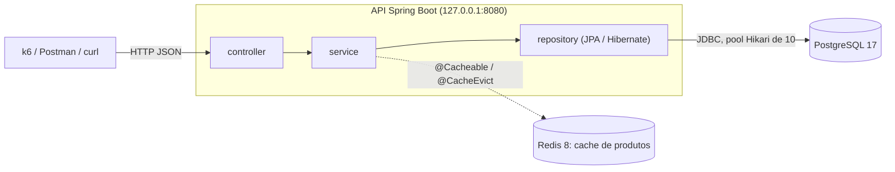

O cache fica na camada de serviço: um HIT responde sem abrir transação e sem ocupar conexão do pool; um MISS
consulta o PostgreSQL e grava o resultado no Redis.

### 2.2. Tecnologias

| Tecnologia | Versão | Por quê |
|---|---|---|
| Java | 21 | versão LTS; `record` para os DTOs |
| Spring Boot | 4.1.2 | Web MVC, Data JPA, Cache, Validation e Actuator integrados |
| Hibernate (JPA) | 7.4.13 | o framework de persistência da aula de LAZY, EAGER e N+1 |
| PostgreSQL | 17 | `EXPLAIN (ANALYZE, BUFFERS)` e estatísticas de uso de índice |
| Redis | 8 | cache em memória, fora da JVM, com TTL por chave (seção 3.3) |
| HikariCP | 7.0.2 | pool de conexões padrão do Spring Boot, com métricas |
| Grafana k6 | 2.4.0 | testes de carga em código, com p95 e p99 nativos (seção 5.1) |
| Docker Compose | v2 | PostgreSQL e Redis reproduzíveis |
| JUnit 6, Mockito, AssertJ | — | testes funcionais |

### 2.3. Camadas e entidades

Pacote `br.uva.pedidos`: `controller` (rotas, sem regra de negócio) → `service` (regras, transações e cache) →
`repository` (Spring Data JPA, JPQL, projeções em DTO). As entidades (`Cliente`, `Produto`, `Pedido`,
`ItemPedido`, e `PedidoEager` só para o experimento) nunca saem da API: entrada e saída usam `record`s em `dto`.
`config` tem o cache e a contagem de SQL; `exception` converte todos os erros em `ProblemDetail` (RFC 9457).

Toda resposta de `/api/**` traz o header **`X-SQL-Count`**, com a quantidade de SQLs da requisição. É a medida de
"acessos ao banco" dos experimentos.

### 2.4. Banco de dados e volume

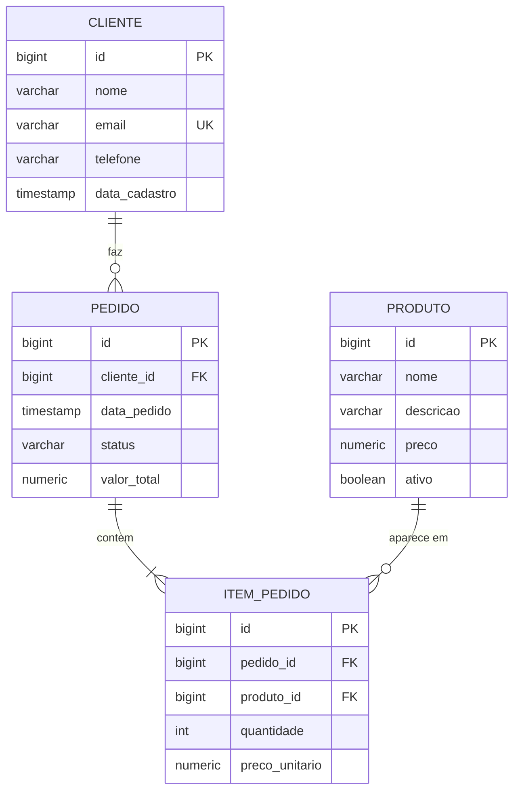

Schema e dados são criados só por SQL ([db/init/](db/init/)). A carga é determinística (`setseed(0.42)`, data de
referência fixa), leva cerca de 9 s e sempre produz o checksum `100000 | 1545590410.75`. Fonte:
[resultados/volume-dados.txt](resultados/volume-dados.txt).

| Tabela | Linhas | Tamanho total |
|---|---:|---:|
| cliente | 10.000 | 1,9 MB |
| produto | 1.000 (901 ativos) | 200 kB |
| pedido | 100.000 | 9,3 MB |
| item_pedido | 299.702 | 30 MB |

Os pedidos se distribuem de forma desigual: o cliente **1** tem 225 pedidos e o **545** tem 9 (a mediana).
Índices iniciais: chaves primárias, `cliente.email` (UNIQUE) e `item_pedido.pedido_id`. O `pedido.cliente_id`
fica **sem índice** de propósito: é o "antes" do experimento de índices.

### 2.5. Endpoints

| Método | Rota | Sucesso |
|---|---|---|
| POST | `/api/clientes` | 201 + `Location` |
| GET | `/api/clientes/{id}` | 200 |
| GET | `/api/clientes/{id}/pedidos?page=0&size=20` | 200, do mais recente ao mais antigo (experimento de índices) |
| POST | `/api/produtos` | 201 + `Location` |
| GET | `/api/produtos/{id}/sem-cache` | 200, sempre consulta o banco (cenário A) |
| GET | `/api/produtos/{id}/com-cache` | 200, consulta o Redis primeiro (cenário B) |
| GET | `/api/produtos/{id}/com-cache-sync` | 200, variante com `@Cacheable(sync = true)` |
| PUT | `/api/produtos/{id}` | 200, invalida o cache do produto |
| POST | `/api/pedidos` | 201 + `Location` |
| GET | `/api/pedidos/{id}` | 200, pedido com cliente e itens (1 SQL) |
| PATCH | `/api/pedidos/{id}/status` | 200 |
| GET | `/api/experimentos/pedidos/{lazy,eager,eager/{id},join-fetch,nativa,resumo-lazy,resumo-eager}?limite=1..1000` | 200, somente leitura (seção 4) |

A coleção [postman/A2.postman_collection.json](postman/A2.postman_collection.json) tem 47 requisições, com casos
de sucesso e de erro.

### 2.6. Regras de negócio

- O pedido exige cliente existente (404) e pelo menos um item, com quantidade de 1 a 1000 (400).
- Cada produto deve existir (404), estar ativo e aparecer uma vez no pedido (422).
- O preço unitário é copiado do produto pelo servidor; reajustes posteriores não alteram pedidos feitos.
- `valorTotal` = Σ(quantidade × preço unitário), calculado pela entidade `Pedido`.
- Todo pedido começa PENDENTE; só valem PENDENTE → APROVADO e PENDENTE → CANCELADO (409).
- O email do cliente é único, inclusive sob requisições simultâneas (409).

### 2.7. Decisões de segurança

- **Usuário da aplicação sem DDL** (só SELECT, INSERT, UPDATE e DELETE); tabelas e índices são criados pelo admin.
- **Segredos só no `.env`**, fora do controle de versão; o repositório traz o `.env.example`.
- **Portas só em `127.0.0.1`**; todos os testes de carga rodaram na máquina local.
- **Serializador tipado no Redis:** só reconstrói `ProdutoDTO`, então quem escrever no Redis não consegue forçar
  a desserialização de outra classe.
- **Erros sem dados internos:** nenhuma resposta expõe SQL, nomes de tabela, classes ou stack trace (15 casos
  conferidos por `ErrosApiTest`).
- **`statement_timeout` de 10 s** na conexão da aplicação.

As demais decisões, com o motivo de cada uma, estão em [docs/decisoes-tecnicas.md](docs/decisoes-tecnicas.md).

## 3. Implementação de cache

### 3.1. Dado escolhido

O dado em cache é o **detalhe do produto** (`ProdutoDTO`: nome, descrição, preço e situação):

| Critério (3.1) | Avaliação |
|---|---|
| Frequência de acesso | Alta: leitura típica de catálogo, feita por todo cliente que navega. |
| Volatilidade | Média: o preço muda por reajuste, mas é lido muito mais vezes do que muda. |
| Custo de recuperação | Baixo por consulta (chave primária), mas repetido a cada visualização. |
| Consequência de dado desatualizado | Só de exibição: a criação de pedido lê o preço do banco. |
| Invalidação | Simples: o produto só muda pelo `PUT /api/produtos/{id}`, que remove a chave dele. |

Estoque, saldo e status do pedido ficaram fora: têm volatilidade alta e servem de base para decisões.

### 3.2. Cenários A e B

As duas versões ficam no `ProdutoService`, com a mesma consulta (`buscarDTO`, projeção JPQL em DTO):

```java
// Cenário A: GET /api/produtos/{id}/sem-cache, consulta o banco a cada chamada.
@Transactional(readOnly = true)
public ProdutoDTO buscarProduto(Long id) {
    return produtoRepository.buscarDTO(id).orElseThrow(() -> naoEncontrado(id));
}

// Cenário B: GET /api/produtos/{id}/com-cache, o resultado fica no Redis até o TTL ou o próximo PUT.
@Cacheable(value = "produtos", key = "#id")
@Transactional(readOnly = true)
public ProdutoDTO buscarProdutoComCache(Long id) { ... mesma consulta ... }

@CacheEvict(value = "produtos", key = "#id")
@Transactional
public ProdutoDTO atualizar(Long id, ProdutoRequest request) { ... }
```

Diferente da aula, o `@CacheEvict` fica no próprio `atualizar`: um `invalidarCache` chamado com `this.` dentro do
service passaria por fora do proxy do Spring e não invalidaria nada.

### 3.3. Tecnologia: Redis

Armazenamento chave-valor em memória, com expiração por chave. Foi escolhido em vez do Caffeine (cache local)
porque fica fora da JVM: sobrevive a reinícios da API, serve a várias instâncias e pode ser inspecionado com
`redis-cli`. O custo é uma ida à rede por consulta.

### 3.4. TTL e invalidação

```java
RedisCacheConfiguration produtos = RedisCacheConfiguration.defaultCacheConfig()
    .entryTtl(ttlProdutos)                      // CACHE_TTL_PRODUTOS, padrão 5 min
    .disableCachingNullValues()                 // produto inexistente responde 404 e não vai para o cache
    .serializeValuesWith(SerializationPair.fromSerializer(new JacksonJsonRedisSerializer<>(ProdutoDTO.class)));
RedisCacheWriter escritor = RedisCacheWriter.create(conexao, config -> config.immediateWrites());
return RedisCacheManager.builder(escritor).withCacheConfiguration("produtos", produtos)
    .transactionAware().enableStatistics().build();
```

- **TTL de 5 minutos**, na faixa de 1 a 5 min que a aula sugere para catálogo de preços.
- **Invalidação após o commit e síncrona:** `transactionAware()` adia a remoção até o commit; `immediateWrites()`
  a torna síncrona (no Spring Data Redis 4.1 ela é assíncrona por padrão). Quando o PUT responde, a chave já saiu.
- **Proxy de cache por fora da transação** (`@EnableCaching(order = HIGHEST_PRECEDENCE)`): um HIT não abre
  transação nem ocupa conexão do pool.
- **Degradação:** com o Redis fora do ar, um `CacheErrorHandler` registra um aviso e a API consulta o banco (200,
  não 500), com custo de cerca de 1 s por consulta (timeout de 500 ms).

### 3.5. Experimento obrigatório

[scripts/experimento-cache.sh](scripts/experimento-cache.sh), com a API em `CACHE_TTL_PRODUTOS=10s` para ver a
expiração. Fonte: [resultados/cache/experimento-cache.txt](resultados/cache/experimento-cache.txt). Os passos
extras (escala do preço, 404, `redis-cli MONITOR`) estão no [apêndice A](docs/apendice-experimentos.md#a-cache-experimento-passo-a-passo).

| Passo do enunciado | Requisição | X-SQL-Count | Redis | Resultado |
|---|---|---:|---|---|
| 1. Consultar e registrar | GET `/com-cache` | 1 | chave criada, TTL 10 s | MISS |
| 2. Repetir a consulta | GET `/com-cache` | 0 | chave existe | HIT, corpo idêntico byte a byte ao do `/sem-cache` |
| 3. Modificar pela aplicação | PUT preço 1419,87 → 1519,87 | 2 | chave removida | invalidação |
| 4. Consultar de novo | GET `/com-cache` (2×) | 1 e 0 | chave recriada | MISS com o preço novo, depois HIT |
| 5. Política de expiração | aguardar 10 s, GET `/com-cache` | 1 | expirou sozinha | MISS por expiração |
| Dado desatualizado | UPDATE direto no banco, GET `/com-cache` | 0 | chave antiga | HIT com o preço antigo |
| | POST `/api/pedidos` com o mesmo produto | 4 | — | o preço cobrado é o do banco |

As duas últimas linhas mostram o dado desatualizado temporário: uma escrita fora da API não invalida a chave, e o
preço antigo aparece até o TTL vencer, sem afetar o valor cobrado.

### 3.6. Comparação com um usuário

Passo 8 do mesmo script: 200 produtos distintos, requisições sequenciais, JVM aquecida.

| Cenário | Média | p95 | SQLs em 200 requisições |
|---|---:|---:|---:|
| A — sem cache | 2,46 ms | 2,90 ms | 200 |
| B — MISS (cache vazio) | 3,66 ms | 4,30 ms | 200 |
| B — HIT (cache cheio) | 2,11 ms | 2,40 ms | 0 |

Com um usuário, o HIT é só 14% mais rápido na média, porque a busca por chave primária já é barata. O MISS é 49%
mais lento que não ter cache: soma a consulta, o GET que falhou e o SET.

### 3.7. Resultados sob carga

Cenário 1 do k6 ([seção 5](#5-testes-de-desempenho)), id sorteado entre os 901 produtos ativos. **HIT:** Redis
pré-carregado antes de cada repetição (taxa de HIT medida: 100,0%). **MISS contínuo:** API com TTL de 1 ms (taxa
de HIT de 0,7% a 0,9%). Fonte: [resumo.md](resultados/carga/resumo.md).

| VUs | Sem cache: req/s · p95 | HIT: req/s · p95 | MISS: req/s · p95 | Pendentes no pool (sem cache) |
|---:|---|---|---|---:|
| 10 | 8.011 · 1,76 ms | 13.638 · 0,94 ms | 4.437 · 3,07 ms | 0 |
| 50 | 7.390 · 14,28 ms | 17.109 · 4,93 ms | 5.058 · 16,11 ms | 38 |
| 100 | 7.311 · 32,62 ms | 17.373 · 10,24 ms | 5.455 · 35,76 ms | 86 |
| 200 | 5.661 · 94,22 ms | 13.953 · 27,99 ms | 5.446 · 80,83 ms | 187 |

Sem cache, há de 1,009 a 1,046 transação no banco por requisição; com HIT, 0,000, nenhuma conexão do pool ativa e
a CPU do PostgreSQL cai de cerca de 180% para 1%.

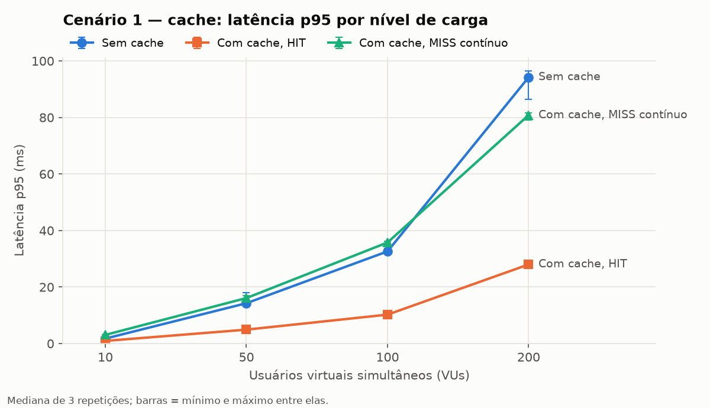

*A distância entre "sem cache" e HIT cresce com a carga: sem cache, as requisições fazem fila no pool.*

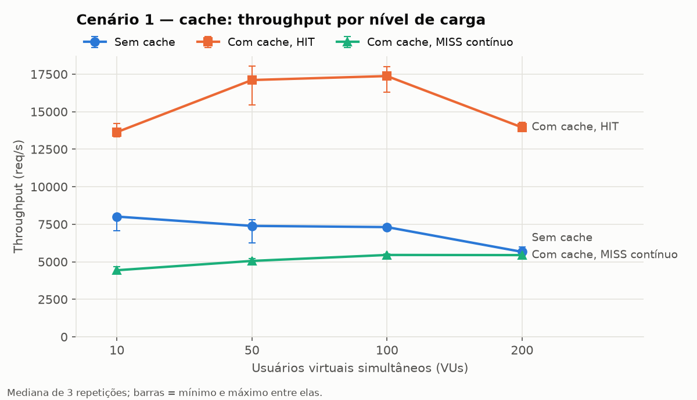

*O HIT sustenta 2,4 vezes o throughput do sem cache com 100 VUs; o MISS fica abaixo do sem cache em todos os níveis.*

**Partida a frio e efeito manada.** Com o Redis vazio (`FLUSHDB` antes da rodada), requisições simultâneas ao
mesmo produto encontram a chave ausente e vão todas ao banco. "MISS redundantes" são os MISS além do primeiro de
cada chave. A variante `/com-cache-sync` (`@Cacheable(sync = true)`) foi medida nas mesmas condições:

| VUs | 10 | 50 | 100 | 200 |
|---|---:|---:|---:|---:|
| MISS redundantes, `@Cacheable` | 6 | 37 | 64 | 128 |
| MISS redundantes, `@Cacheable(sync = true)` | 7 | 38 | 66 | 137 |

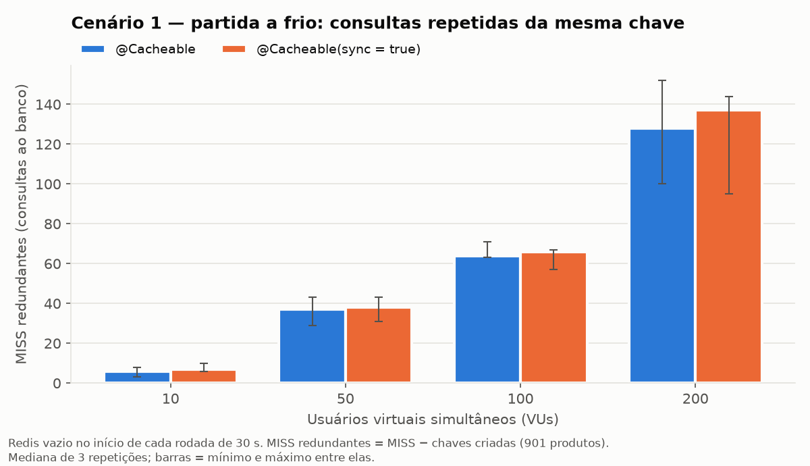

*As barras de cada nível são praticamente iguais: o `sync = true` não reduziu o efeito manada.*

A premissa de que o `sync` "trava por instância da JVM" não vale nesta versão: o Spring delega o `sync` ao
provedor, e o `RedisCache` do Spring Data Redis 4.1, com o writer padrão, não usa trava nenhuma (conferido no
bytecode; [apêndice A](docs/apendice-experimentos.md#por-que-sync--true-não-sincroniza-nesta-versão)). Na
prática, o efeito manada custou cerca de 1.000 MISS numa rodada de 30 s com 99,8% de HIT.

### 3.8. Questões da seção 3.5

**1. Em quais situações o cache apresentou maior benefício?**
Em leituras repetidas com HIT e carga alta: com 100 a 200 VUs, o throughput foi de 2,4 a 2,5 vezes o do sem
cache e o p95 caiu de 3,2 a 3,4 vezes. O ganho vem de tirar o banco do caminho (0 transações por requisição,
nenhuma conexão do pool). Com um usuário, o ganho foi de só 14% (2,46 → 2,11 ms): o benefício cresce com a
concorrência.

**2. Como a volatilidade dos dados influenciou a escolha do TTL?**
O preço tem volatilidade média, e toda alteração pela API já invalida a chave. O TTL só limita a vida de um dado
alterado por fora da API, e 5 minutos ficam dentro do sugerido para catálogo de preços. No outro extremo, com TTL
de 1 ms o cache nunca acerta e o desempenho fica pior que sem cache.

**3. Quais são os riscos de utilizar informações desatualizadas?**
Exibir um preço que não é mais o vigente. Acontece se o banco for alterado por fora da API (demonstrado no
experimento), se o Redis estiver fora do ar na invalidação, ou numa corrida em que uma leitura antiga grava no
cache logo depois do evict. Nos três casos, o TTL limita a duração a 5 minutos. O valor cobrado não é afetado,
porque a criação de pedido lê o preço do banco (`findAllById`).

**4. O cache sempre melhorou o desempenho? Justifique com os resultados observados.**
Não. No **MISS**, a latência média foi 1,86 vez a do sem cache com 10 VUs, 1,34 com 100 e 1,04 com 200, e o
throughput ficou abaixo em todos os níveis (4.437 × 8.011 req/s com 10 VUs). Com o **Redis fora do ar**, cada
consulta espera o timeout (cerca de 1 s). Na **partida a frio**, o efeito manada gera consultas redundantes que o
`sync = true` não evitou. O cache só compensa com taxa de HIT alta: dados lidos muitas vezes entre duas alterações.

## 4. Otimização das consultas

### 4.1. LAZY × EAGER

Relacionamentos estudados: Pedido → Itens (`@OneToMany`) e Pedido → Cliente (`@ManyToOne`). Como um mapeamento só
aceita um `FetchType`, há duas entidades sobre a mesma tabela; o `Pedido` da API continua LAZY.

```java
@Entity @Table(name = "pedido")             // usada pela API e pelo experimento LAZY
public class Pedido {
    @ManyToOne(fetch = FetchType.LAZY, optional = false) private Cliente cliente;
    @OneToMany(mappedBy = "pedido", fetch = FetchType.LAZY, cascade = CascadeType.ALL) private List<ItemPedido> itens;
}

@Entity @Immutable @Table(name = "pedido")  // somente leitura, só para o experimento EAGER
public class PedidoEager {
    @ManyToOne(fetch = FetchType.EAGER, optional = false) private Cliente cliente;
    @OneToMany(fetch = FetchType.EAGER) @JoinColumn(name = "pedido_id", insertable = false, updatable = false)
    private List<ItemPedido> itens;
}
```

As rotas `/api/experimentos/pedidos/*` devolvem os `limite` primeiros pedidos com cliente e itens; o JSON de
LAZY, EAGER, JOIN FETCH e nativa é **idêntico** em todos os limites (conferido pelo script). O `open-in-view` está
desligado, para que o LAZY não seja carregado escondido na serialização.

**Resultados** ([scripts/experimento-persistencia.sh](scripts/experimento-persistencia.sh), mediana de 5
requisições após 3 de aquecimento; fonte: [persistencia.txt](resultados/persistencia/persistencia.txt); tabela
completa no [apêndice B](docs/apendice-experimentos.md#b-lazy-eager-e-consultas-otimizadas-tabela-completa)):

| Estratégia | SQLs (10 / 100 / 1000 pedidos) | Mediana (10 / 100 / 1000) |
|---|---|---|
| LAZY | 21 / 201 / 1.937 | 12,33 / 48,10 / 237,18 ms |
| EAGER (consulta de lista) | 21 / 201 / 1.937 | 10,91 / 45,12 / 233,30 ms |
| JOIN FETCH | 2 / 2 / 2 | 9,64 / 14,69 / 44,89 ms |
| SQL nativo | 1 / 1 / 1 | 6,43 / 7,84 / 13,13 ms |
| EAGER por id (`findById`) | 1 (um pedido) | 4,59 ms |

O volume recuperado é o mesmo em todas as estratégias: 2.713, 29.391 e 295.258 bytes (26, 299 e 2.995 itens).

**N+1 demonstrado.** Com `/lazy?limite=3` ([sql-lazy.txt](resultados/persistencia/sql-lazy.txt)), cada
`getCliente()` ou `getItens()` do laço de mapeamento dispara um SELECT:

```
-- SQL 1  select ... from pedido p1_0 order by p1_0.id fetch first ? rows only    <- [3]
-- SQL 2  select ... from cliente c1_0 where c1_0.id=?                            <- [8062]  pedido 1: getCliente()
-- SQL 3  select ... from item_pedido i1_0 where i1_0.pedido_id=?                 <- [1]     pedido 1: getItens()
-- SQL 4  select ... from cliente c1_0 where c1_0.id=?                            <- [3713]  pedido 2
-- ...    (mais 3: itens do pedido 2, cliente e itens do pedido 3)
```

São **1 + N (itens) + clientes distintos** consultas: 21 para 10 pedidos e 1.937 para 1000 (1 + 1000 + 936
clientes distintos; um cliente já carregado é reaproveitado do contexto de persistência).

**EAGER em lista: o mesmo N+1**, como o enunciado alerta. Por `findById` (`/eager/1`), o Hibernate faz **1
consulta** com JOIN ([sql-eager-por-id.txt](resultados/persistencia/sql-eager-por-id.txt)). Numa consulta de
lista, o JPQL traz só `pedido`, e cada associação EAGER é inicializada com um SELECT separado: **1 + N + clientes
distintos, como o LAZY** ([sql-eager.txt](resultados/persistencia/sql-eager.txt)). O EAGER define **quando**
carregar, não **como**.

**Dados desnecessários: o grid da aula** (pedido, cliente e valor, sem itens). Com LAZY (`/resumo-lazy`), a coleção
nunca é carregada: 937 SQLs e 90,42 ms para 1000 pedidos. Com EAGER (`/resumo-eager`), o Hibernate carrega os
2.995 itens mesmo assim: 1.937 SQLs e 233,06 ms, **2,6 vezes mais lento para a mesma resposta**.

#### Quando usar LAZY ou EAGER (4.3)

- **LAZY como padrão**, como na aula: só busca o que é acessado. Contra o N+1 de uma listagem, a solução é uma
  consulta específica (JOIN FETCH, projeção em DTO), não trocar o mapeamento.
- **EAGER só quando a associação é sempre necessária, pequena e lida por id** (um pedido aberto na tela de
  detalhes). Ele vale para todas as consultas da entidade, inclusive as que não usam o dado, e em listas continua
  sendo N+1.

### 4.2. Consultas otimizadas

**JOIN FETCH em dois passos** (JPQL, 2 consultas para qualquer limite; [sql-join-fetch.txt](resultados/persistencia/sql-join-fetch.txt)):

```java
List<Long> ids = entityManager.createQuery("SELECT p.id FROM Pedido p ORDER BY p.id", Long.class)
    .setMaxResults(limite).getResultList();
entityManager.createQuery("""
        SELECT p FROM Pedido p JOIN FETCH p.cliente JOIN FETCH p.itens
        WHERE p.id IN :ids ORDER BY p.id""", Pedido.class).setParameter("ids", ids).getResultList();
```

Num passo só, o `setMaxResults` com JOIN FETCH de coleção não vira `LIMIT`: o Hibernate pagina em memória (aviso
`HHH90003004`) depois de ler todos os pedidos.

**SQL nativo** (1 consulta; o limite vale para os pedidos, na subconsulta; as linhas são agrupadas em Java):

```sql
SELECT p.id, p.data_pedido, p.status, p.valor_total, c.nome AS cliente_nome,
       i.produto_id, i.quantidade, i.preco_unitario
FROM (SELECT * FROM pedido ORDER BY id LIMIT :limite) p
JOIN cliente c ON c.id = p.cliente_id
JOIN item_pedido i ON i.pedido_id = p.id
ORDER BY p.id, i.id
```

**Comparação isolada** (tabela da seção 4.1): com 1000 pedidos, o JOIN FETCH foi 5,3 vezes mais rápido que o
LAZY (44,89 × 237,18 ms). Com 10 pedidos a diferença é menor (12,33 × 9,64 ms).

**Sob carga** (cenário 2 do k6, `limite=20`: o LAZY faz 1 + 20 + 20 = 41 SQLs, pois os 20 primeiros pedidos têm
20 clientes distintos). Fonte: [resumo.md](resultados/carga/resumo.md).

| VUs | LAZY: req/s · p95 | EAGER: req/s · p95 | JOIN FETCH: req/s · p95 | SQL nativo: req/s · p95 |
|---:|---|---|---|---|
| 10 | 681 · 20,75 ms | 699 · 21,40 ms | 2.816 · 5,28 ms | 3.372 · 4,52 ms |
| 50 | 727 · 109,02 ms | 714 · 108,18 ms | 3.025 · 31,58 ms | 3.567 · 25,98 ms |
| 100 | 725 · 221,71 ms | 717 · 215,37 ms | 3.005 · 66,24 ms | 3.496 · 57,36 ms |
| 200 | 753 · 431,57 ms | 732 · 449,27 ms | 2.989 · 139,26 ms | 3.504 · 116,82 ms |

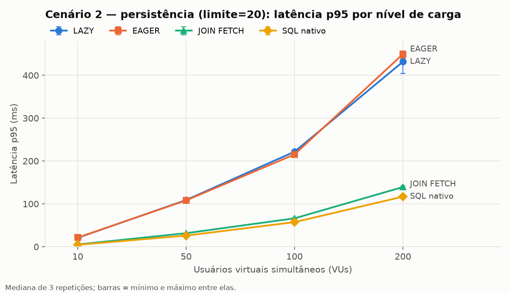

*LAZY e EAGER se sobrepõem em todos os níveis; JOIN FETCH e nativo ficam juntos, bem abaixo.*

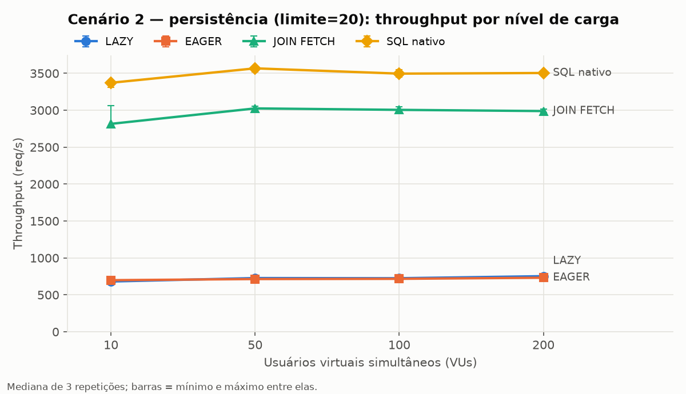

*O throughput de cada estratégia é praticamente constante desde 10 VUs: o pool de 10 conexões já está saturado.*

#### O SQL nativo trouxe benefícios reais? Manutenção e portabilidade (4.4)

**Ganho real, mas pequeno depois do JOIN FETCH.** Isolado, com 1000 pedidos, o nativo foi 3,4 vezes mais rápido
que o JOIN FETCH (13,13 × 44,89 ms); sob carga, com 20 pedidos, a vantagem foi de 16% a 20% em throughput. O salto
grande veio de eliminar o N+1 (4,0 a 4,2 vezes sob carga). O nativo seleciona só as 8 colunas usadas, não cria
entidades gerenciadas e faz uma ida ao banco a menos; a CPU da API mostra a diferença (cerca de 460% no JOIN FETCH
contra 288% no nativo).

**Custos:** mapeamento manual (aliases, `addScalar` com tipos, conversão do `status`) numa string que o compilador
não verifica; nenhuma validação na subida (o `ddl-auto: validate` confere entidades, não SQL nativo, e uma coluna
renomeada só quebra na execução); **portabilidade** menor (`LIMIT` e subconsulta no `FROM` seguem o dialeto do
PostgreSQL, enquanto o JPQL é traduzido pelo Hibernate para qualquer banco); e o resultado é um DTO, não serve para
alterar e salvar.

**Conclusão:** o JOIN FETCH resolve o problema principal e mantém a portabilidade. O nativo se justifica em pontos
quentes ou relatórios em que os 16% a 20% restantes importam; uma projeção JPQL em DTO, como o `buscarDTO`,
captura parte desse ganho sem perder a portabilidade.

### 4.3. Índices

**Consulta escolhida:** "pedidos de um cliente, do mais recente para o mais antigo", a do enunciado e do slide. É
a que a API executa em `GET /api/clientes/{id}/pedidos` (SQL copiado do log do Hibernate):

```sql
select p1_0.id, p1_0.data_pedido, p1_0.status, p1_0.valor_total
from pedido p1_0 where p1_0.cliente_id=? order by p1_0.data_pedido desc fetch first ? rows only
```

Ela combina filtro, ordenação e limite. O "antes" existe porque o PostgreSQL não indexa chaves estrangeiras
automaticamente. Também foram analisadas a consulta do enunciado (sem limite) e a do slide (com intervalo de datas).

**Índice composto:**

```sql
CREATE INDEX idx_pedido_cliente_data ON pedido (cliente_id, data_pedido DESC);
```

`cliente_id` primeiro (filtro de igualdade); `data_pedido DESC` depois, para que as entradas de um cliente já
fiquem na ordem do `ORDER BY`: o banco não ordena e, com `LIMIT 20`, para após 20 entradas.

**Estados medidos:** [scripts/experimento-indice.sh](scripts/experimento-indice.sh) percorre **sem → simples
(`cliente_id`) → composto → sem**; o último "sem", na JVM já aquecida, é o controle de aquecimento. Fonte: [indice.csv](resultados/indice/indice.csv) e [resultados/explain/](resultados/explain/)
(os 32 planos no [apêndice C](docs/apendice-experimentos.md#c-índices-todos-os-planos)).

Consulta da API, página 0. Banco: mediana de 10 `EXPLAIN ANALYZE`; API: mediana de 20 requisições.

| Estado | Cliente | Varredura | Sort | Linhas lidas | Removidas pelo filtro | Buffers | Banco | API |
|---|---:|---|---|---:|---:|---:|---:|---:|
| sem | 1 | Seq Scan | top-N heapsort | 225 | 99775 | 907 | 4,825 ms | 9,110 ms |
| simples | 1 | Bitmap Heap Scan | top-N heapsort | 225 | 0 | 209 | 0,204 ms | 4,655 ms |
| composto | 1 | **Index Scan** | **nenhum** | 20 | 0 | 26 | **0,054 ms** | 4,165 ms |
| sem (controle) | 1 | Seq Scan | top-N heapsort | 225 | 99775 | 907 | 3,523 ms | 7,750 ms |
| sem | 545 | Seq Scan | quicksort | 9 | 99991 | 907 | 5,107 ms | 9,590 ms |
| composto | 545 | Bitmap Heap Scan | quicksort | 9 | 0 | 18 | 0,083 ms | 4,380 ms |

Planos do cliente 1 ([sem_A_pagina0_cliente1.txt](resultados/explain/sem_A_pagina0_cliente1.txt),
[composto_A_pagina0_cliente1.txt](resultados/explain/composto_A_pagina0_cliente1.txt)):

```
-- sem índice: lê a tabela inteira, descarta 99.775 linhas e ordena as 225 restantes
Limit  (actual time=4.999..5.002 rows=20 loops=1)
  ->  Sort  Sort Key: data_pedido DESC  Sort Method: top-N heapsort
        ->  Seq Scan on pedido p1_0  (actual rows=225)  Filter: (cliente_id = 1)  Rows Removed by Filter: 99775

-- índice composto: sem Sort; lê na ordem do índice e para após 20 linhas
Limit  (actual time=0.090..0.217 rows=20 loops=1)
  ->  Index Scan using idx_pedido_cliente_data on pedido p1_0  (actual rows=20)
        Index Cond: (cliente_id = 1)   Buffers: shared hit=26
```

**Observado, não presumido.** Com o composto disponível, o planejador preferiu Bitmap Heap Scan + Sort em três
casos: o cliente 545 (com 9 linhas, o `LIMIT 20` não corta nada), a consulta sem limite (ler 225 linhas em 201
páginas na ordem física e ordenar custou 484,66 no plano, contra 707,79 do Index Scan) e a consulta com intervalo
(o intervalo de datas entrou no `Index Cond`, e nenhuma linha foi removida por filtro). O índice foi usado nos três;
mudou a forma de usá-lo.

**Custos** (inserção de 10.000 pedidos em `BEGIN ... ROLLBACK`, mediana de 5; [indice.txt](resultados/indice/indice.txt)):

| | Sem índice extra | + simples | + composto |
|---|---:|---:|---:|
| Tamanho do índice | — | 920 kB | 3.104 kB (43% da tabela de 7.232 kB) |
| WAL gerado na inserção | 2.136 KB | 2.815 KB | 2.842 KB (+33%) |
| Tempo da inserção | 105,332 ms | 114,583 ms | 112,936 ms |

O tempo variou de 100 a 141 ms entre execuções e não é conclusivo; o WAL é determinístico e mostra o custo.

**Sob carga** (cenário 3 do k6: clientes 1 a 5, com 85 a 225 pedidos cada; estado alternado a cada repetição).
Fonte: [resumo.md](resultados/carga/resumo.md).

| VUs | Sem índice: req/s · p95 | Com índice: req/s · p95 | Throughput |
|---:|---|---|---:|
| 10 | 992 · 14,44 ms | 6.937 · 1,97 ms | 7,0× |
| 50 | 1.019 · 82,04 ms | 7.013 · 14,70 ms | 6,9× |
| 100 | 1.003 · 177,14 ms | 6.816 · 35,29 ms | 6,8× |
| 200 | 1.018 · 364,41 ms | 6.780 · 76,02 ms | 6,7× |

O `idx_scan` subiu de 1,01 a 1,04 por requisição com o índice e 0 sem ele, o que confirma o estado de cada rodada.

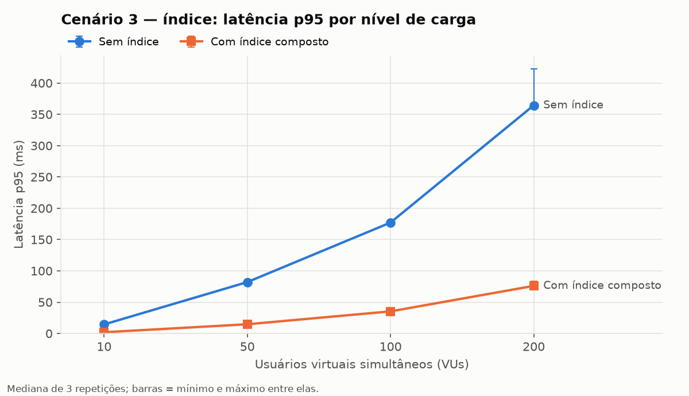

*Sem índice, o p95 cresce na proporção dos VUs (177 ms com 100, 364 ms com 200); com o índice, fica de 4,8 a 7,3 vezes menor.*

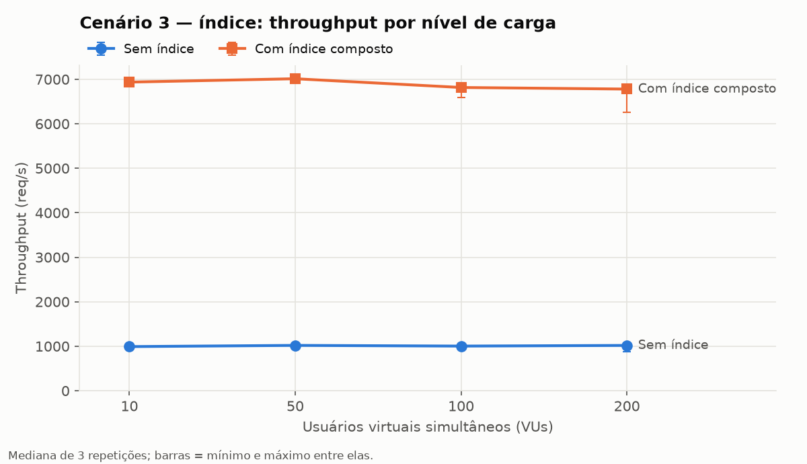

*Os dois patamares são constantes: cerca de 1.000 req/s sem índice e de 6.780 a 7.013 req/s com ele.*

#### Respostas da seção 5.4

**1. O índice foi efetivamente utilizado pelo banco?**
Sim, em todas as consultas dos estados com índice; na da API para o cliente 1, da forma ideal (Index Scan sem
Sort, parando em 20 linhas). A aplicação também o usou: `idx_scan` +4 com 4 requisições e cerca de 1 por requisição
sob carga.

**2. Houve redução no tempo de execução?**
Sim. No banco, de 3,5–4,8 ms para 0,054 ms (de 65 a 90 vezes menos), com 26 páginas lidas em vez de 907. Na API
isolada, de 7,750 ms (controle) para 4,165 ms, porque o resto da requisição (HTTP, Spring, serialização) não muda.
Sob carga, o throughput subiu de 6,7 a 7,0 vezes, e cada transação passou a ler 23,0 blocos e 20,0 tuplas, contra
903,6 blocos e cerca de 99.950 tuplas (a tabela inteira).

**3. Quais fatores influenciaram o resultado?**
A **seletividade** (225 linhas usaram Index Scan; 9 linhas, Bitmap); o **`LIMIT`**, que deixa o Index Scan parar
cedo; a **dispersão física** das linhas (225 pedidos em 201 páginas), que favorece o bitmap quando é preciso ler
tudo; a **ordem das colunas** (o índice simples manteve o Sort); e o **tamanho da tabela**: os 7 MB cabem na
memória do PostgreSQL, por isso todo acesso foi `hit`. Em disco, a diferença seria maior.

**4. Quais podem ser os custos de manter índices adicionais?**
Espaço (3,1 MB, 43% da tabela), escrita (+33% de WAL por inserção, com custo semelhante em UPDATEs dessas colunas
e em DELETEs), manutenção (VACUUM, inchaço) e mais planos para o planejador avaliar.

**5. Criar índices em todas as colunas consultadas seria uma boa estratégia? Por quê?**
Não. É a armadilha do algoritmo guloso: cada índice é um ótimo local para uma leitura, mas toda escrita paga por
todos. Muitos nem seriam usados (uma coluna como `status`, com 3 valores, levaria a Seq Scan de qualquer forma), e
índices de uma coluna não resolvem filtro e ordenação juntos, como mostrou o simples. O critério é indexar as
consultas frequentes e caras, na ordem em que usam as colunas, e confirmar com `EXPLAIN ANALYZE` e
`pg_stat_user_indexes`.

## 5. Testes de desempenho

### 5.1. Ferramenta: Grafana k6

O k6, apresentado na aula, descreve os testes em JavaScript ([k6/](k6/)), calcula p95 e p99 nativamente e grava o
resumo de cada rodada em JSON, de onde saem as tabelas e os gráficos. Foi preferido ao JMeter porque o teste em
código é versionado, revisável e roda por script, sem interface gráfica.

### 5.2. Modelo de carga, cenários e níveis

Executor `constant-vus`, **sem think time** (modelo fechado): cada VU faz a próxima requisição assim que recebe a
anterior. Por isso **VUs não são requisições por segundo**: o throughput é o resultado medido e cai quando a
latência sobe. Todos os testes são só de leitura.

| Cenário | Requisição | Alvos comparados |
|---|---|---|
| 1 — cache ([k6/cache.js](k6/cache.js)) | `GET /api/produtos/{id}/{alvo}`, id sorteado entre os 901 ativos | sem cache; HIT (pré-carregado); MISS contínuo (TTL de 1 ms); partida a frio (`FLUSHDB` antes), com e sem `sync` |
| 2 — persistência ([k6/persistencia.js](k6/persistencia.js)) | `GET /api/experimentos/pedidos/{alvo}?limite=20` | LAZY, EAGER, JOIN FETCH, SQL nativo |
| 3 — índice ([k6/indice.js](k6/indice.js)) | `GET /api/clientes/{id}/pedidos?page=0&size=20`, clientes 1 a 5 | sem índice × com índice composto |

**Níveis** de 10, 50, 100 e 200 VUs; **rodadas** de 10 s de aquecimento descartado + 30 s medidos; **3
repetições** por nível, com os alvos intercalados; **132 rodadas** em cerca de 115 minutos. No cenário 2, o
`limite=20` evita que o LAZY, com cerca de 1.937 SQLs por requisição em 1000 pedidos, só meça a fila do pool.

### 5.3. Cuidados adotados (6.5)

| Cuidado | O que foi feito |
|---|---|
| Ambiente e configuração equivalentes | mesma máquina e mesma instância da API para todos os alvos de um bloco; pool de 10 conexões; log de SQL desligado |
| Mesma carga para comparar | mesmos níveis, duração e repetições para todos os alvos de um cenário |
| Quantidade de dados registrada | 100.000 pedidos, 299.702 itens, 10.000 clientes, 1.000 produtos; checksum conferido no fim |
| Estado inicial do cache controlado | HIT: pré-carga antes de cada repetição; MISS: TTL de 1 ms; frio: `FLUSHDB` logo antes; taxa de HIT medida em cada rodada |
| Aquecimento | 30 s a 50 VUs no início de cada bloco e 10 s descartados antes de cada rodada |
| Atividades simultâneas | blocos rodados sem outras tarefas do projeto; processos ativos registrados no início de cada bloco |
| Repetição | 3 repetições; tabelas com a mediana e, no [resumo.md](resultados/carga/resumo.md), o mínimo e o máximo |
| Ambiente próprio | tudo em `127.0.0.1`, numa máquina local |

### 5.4. Métricas e ambiente

- **Do k6:** latência média, mediana, p95, p99 e máxima, throughput e taxa de erros (`check` de status 200).
- **A cada ~2 s:** CPU da API, do k6, do PostgreSQL e do Redis (em % de um núcleo), memória da JVM, conexões ativas
  e pendentes do pool, acertos e falhas do cache.
- **Por rodada:** deltas de `pg_stat_database` (transações, blocos e tuplas lidos), `cache.gets` e `idx_scan`.

**Ambiente** ([ambiente.txt](resultados/carga/ambiente.txt)): notebook com Ubuntu 24.04.5, Intel i5-1235U (CPU
móvel de 15 W, 12 núcleos lógicos) e 15 GiB de RAM; Java 21.0.13, PostgreSQL 17.12, Redis 8.10.3, k6 v2.4.0. k6,
API, PostgreSQL e Redis rodaram na mesma máquina.

**Checagem da partida a frio.** Na bateria principal, a partida a frio superou o HIT pré-carregado com 100 VUs
(19.451 × 17.373 req/s), embora as duas sejam quase 100% HIT. A suspeita era a ordem: o HIT sempre rodava logo
depois do sem cache, que exige o máximo do PostgreSQL. Intercalando as duas condições (HIT, frio, HIT, frio, HIT,
frio) com o mesmo aquecimento, a diferença se inverteu: HIT com 14.618 e frio com 13.742 req/s, com faixas
sobrepostas (11.898–15.769 × 13.492–14.970). Era efeito de ordem e de temperatura da CPU, não do cache. Fonte:
[checagem-frio-hit/resumo.md](resultados/carga/checagem-frio-hit/resumo.md).

### 5.5. Resultados com 100 VUs

Mediana de 3 repetições. Fonte: [resultados/carga/resumo.md](resultados/carga/resumo.md), com os 4 níveis, o mínimo
e o máximo, CPU, memória, pool e banco.

| Cenário | Alvo | Média | p95 | p99 | Throughput | Erros |
|---|---|---:|---:|---:|---:|---:|
| Cache | sem cache | 13,46 ms | 32,62 ms | 47,47 ms | 7.311 req/s | 0,00% |
| | HIT | 5,52 ms | 10,24 ms | 14,10 ms | 17.373 req/s | 0,00% |
| | MISS contínuo | 17,99 ms | 35,76 ms | 49,15 ms | 5.455 req/s | 0,00% |
| | partida a frio | 4,94 ms | 9,09 ms | 12,45 ms | 19.451 req/s | 0,00% |
| | partida a frio, `sync` | 4,95 ms | 9,24 ms | 12,51 ms | 19.414 req/s | 0,00% |
| Persistência | LAZY | 137,23 ms | 221,71 ms | 308,30 ms | 725 req/s | 0,00% |
| | EAGER | 138,95 ms | 215,37 ms | 309,16 ms | 717 req/s | 0,00% |
| | JOIN FETCH | 33,07 ms | 66,24 ms | 91,03 ms | 3.005 req/s | 0,00% |
| | SQL nativo | 28,43 ms | 57,36 ms | 76,46 ms | 3.496 req/s | 0,00% |
| Índice | sem índice | 99,27 ms | 177,14 ms | 213,43 ms | 1.003 req/s | 0,00% |
| | com índice | 14,48 ms | 35,29 ms | 49,15 ms | 6.816 req/s | 0,00% |

Nenhuma rodada teve erro, em nenhum nível; a maior latência individual foi 1,38 s, abaixo do timeout de 5 s do
pool. Os gráficos de p95 e throughput estão nas seções 3.7, 4.2 e 4.3; os abaixo comparam média, p95 e p99:

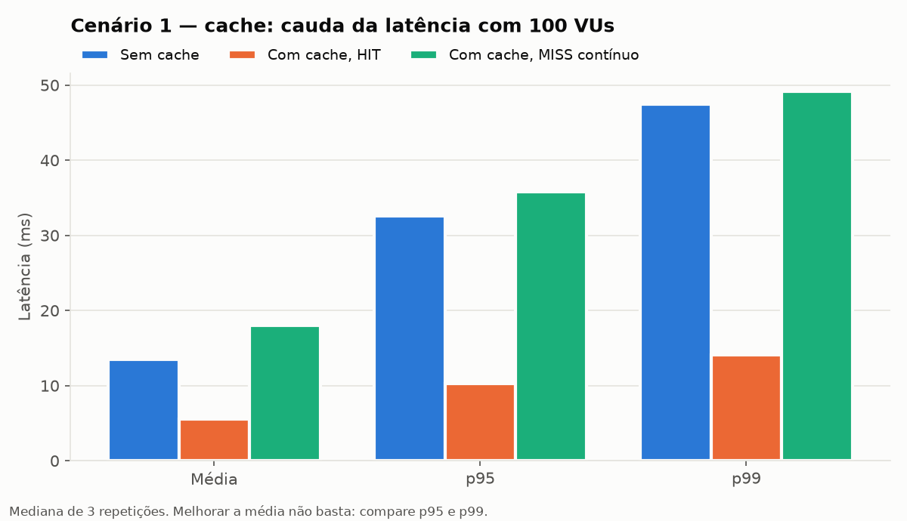

*Sem cache tem a cauda mais longa (p99 de 3,5 vezes a média, pela fila no pool); o HIT encurta as três medidas.*

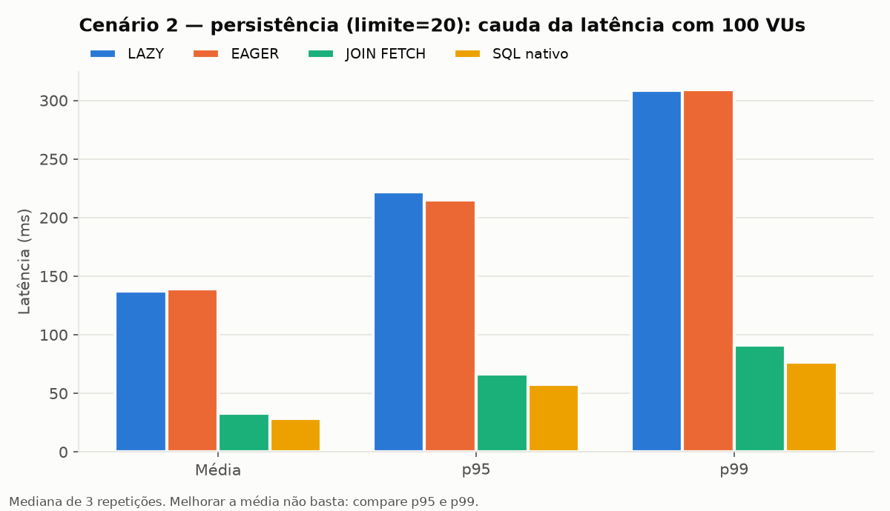

*LAZY e EAGER são iguais nas três medidas; o p99 do LAZY (308 ms) é quatro vezes o do SQL nativo (76 ms).*

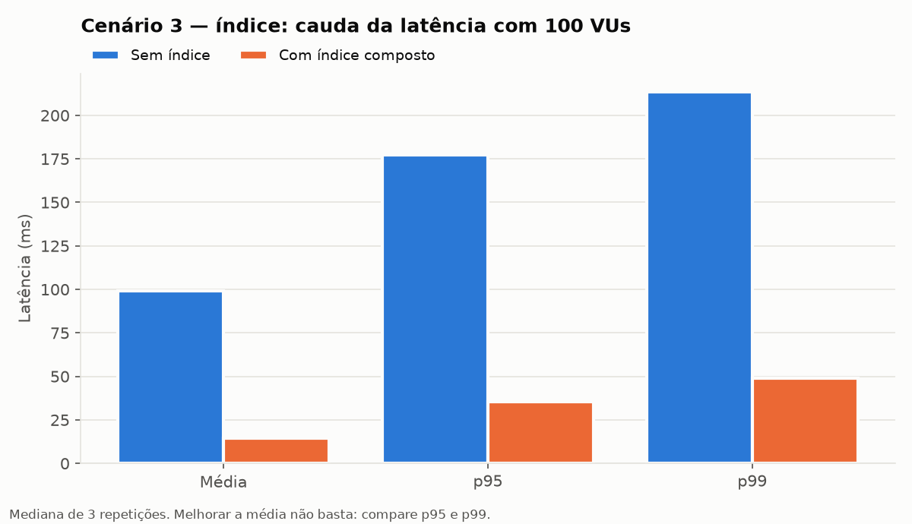

*O índice reduz a média em 6,9 vezes, mas o p99 em 4,3 vezes: a cauda melhora menos que a média.*

### 5.6. Testes funcionais

`./mvnw clean verify` roda **87 testes** (1 pulado por padrão: o de `statement_timeout`, que leva 11 s). São **25
unitários** (regras de status, cálculo do total, criação de pedido com repositórios mockados) e **62 de
integração** (`@SpringBootTest` + MockMvc contra o PostgreSQL e o Redis do Compose: códigos HTTP, formato dos
erros, invalidação do cache, `X-SQL-Count` de cada estratégia, JSON idêntico entre elas). Lista por classe no
[apêndice E](docs/apendice-experimentos.md#e-testes-funcionais-por-classe).

Os funcionais verificam se o sistema **faz a coisa certa** (passa ou falha); os de desempenho medem **quão bem**
ele responde sob carga. Um não substitui o outro: os funcionais garantem que as quatro estratégias de consulta
devolvem a mesma resposta, o que torna válida a comparação de desempenho entre elas.

## 6. Discussão

### 6.1. Questões da seção 6.7

**1. Qual técnica apresentou os maiores ganhos de desempenho?**
O **índice composto**: throughput de 6,7 a 7,0 vezes maior e p95 de 4,8 a 7,3 vezes menor, em todos os níveis. Por
transação, o banco passou de 903,6 blocos e cerca de 99.950 tuplas para 23,0 blocos e 20,0 tuplas. Em seguida vêm
as **consultas otimizadas** (JOIN FETCH com 4,0 a 4,2 vezes e SQL nativo com 4,7 a 5,0 vezes o throughput do LAZY)
e o **cache com HIT** (1,7 a 2,5 vezes).

**2. Os ganhos foram mantidos quando a carga aumentou?**
**Índice e consultas: sim, quase constantes**, porque os dois lados já estão saturados com 10 VUs (índice 7,0× →
6,7×; nativo sobre LAZY 5,0× → 4,7×). **Cache: o ganho cresceu**, de 1,7 vez (10 VUs) para 2,3, 2,4 e 2,5 em
throughput, e de 1,9 para 3,4 no p95: sem cache, as requisições disputam o pool (até 187 pendentes) e o throughput
cai de 8.011 para 5.661 req/s; com HIT, o pool não é usado. Com 200 VUs, o HIT também cai (17.373 → 13.953 req/s),
limitado pela CPU da máquina.

**3. Houve diferenças relevantes entre latência média, p95 e p99?**
Sim. Com 200 VUs, o p95 ficou entre 1,6 e 2,7 vezes a média, e o p99 entre 2,1 e 3,8 vezes. A cauda é mais longa
onde a espera é desigual: **sem cache, o p99 foi 3,8 vezes a média** (133,48 × 35,04 ms), pela fila do pool. LAZY e
EAGER têm cauda proporcionalmente curta (p99 de 2,1 a 2,2 vezes a média), mas a pior em valor absoluto (557,30 e
599,50 ms). E melhorar a média não basta: com 200 VUs, o índice reduziu a média em 6,7 vezes (195,48 → 29,29 ms) e
o p99 em só 4,1 vezes (429,99 → 105,79 ms).

**4. Alguma otimização apresentou resultados inferiores aos esperados?**
- **Cache com MISS foi mais lento que sem cache** (seção 3.8). Com 200 VUs, o p95 do MISS (80,83 ms) ficou abaixo
  do sem cache (94,22 ms) com throughput parecido; uma hipótese não verificada é que as idas ao Redis espaçam a
  chegada ao pool (168 × 187 pendentes).
- **`sync = true` não reduziu o efeito manada** (128 × 137 MISS redundantes com 200 VUs; seção 3.7).
- **EAGER não trouxe ganho nenhum sobre LAZY** (725 × 717 req/s com 100 VUs): em lista, os dois fazem as mesmas
  41 consultas.
- **O SQL nativo rendeu só 16% a 20% a mais que o JOIN FETCH** sob carga, contra 3,4 vezes no teste isolado com
  1000 pedidos: com 20 pedidos, montar entidades pesa menos.

**5. Quais foram os principais gargalos identificados?**

| Gargalo | Onde | Evidência |
|---|---|---|
| Pool Hikari (10 conexões) | sem cache, MISS, persistência, índice | 10 conexões ativas o tempo todo e pendentes ≈ VUs − 10 (até 189 com 200 VUs); throughput constante e latência crescendo com os VUs |
| CPU do PostgreSQL | sem índice | PostgreSQL com 798% a 816% (cerca de 8 núcleos) e API com só 84% a 91%: cada requisição varre a tabela |
| CPU da máquina | cache com HIT e partida a frio | API com cerca de 480% e k6 com cerca de 420% (quase 9 dos 12 núcleos lógicos); PostgreSQL ocioso (1%) |
| CPU da API | JOIN FETCH | API com 433% a 460% contra 267% a 289% do nativo; PostgreSQL mais baixo (246% a 255% × 406% a 430%) |
| k6 na mesma máquina | todos | de 33% (LAZY) a 423% (HIT) de CPU, disputando núcleos com a API nos cenários mais rápidos |

**6. Como a redução das consultas ao banco influenciou o desempenho?**
De forma direta. **Persistência:** com 2 e 1 SQLs em vez de 41, o throughput subiu de cerca de 720 para 3.000 e
3.500 req/s com as mesmas 10 conexões, que cada requisição segura por menos tempo. **Cache:** de cerca de 1
transação por requisição para 0,000 com HIT; o pool sai do caminho e o gargalo passa para a CPU. **Índice:** a
quantidade de consultas não mudou, mas cada uma lê 20 tuplas em vez de cerca de 99.950; menos trabalho por consulta
teve o mesmo efeito que menos consultas.

**7. Quais são os possíveis custos ou riscos das otimizações adotadas?**

| Técnica | Ganho | Custo ou risco |
|---|---|---|
| Cache Redis | 2,4× o throughput com HIT; banco fora do caminho | dado desatualizado por até 5 min se o banco mudar por fora da API; MISS mais caro que não ter cache; efeito manada na partida a frio, sem proteção pelo `sync` nesta versão; mais um serviço para operar (Redis fora = cerca de 1 s por requisição) |
| JOIN FETCH | 4,1× o throughput do LAZY; JPQL portável | mais CPU na API (entidades gerenciadas); exige dois passos para não paginar em memória |
| SQL nativo | +16% a 20% sobre o JOIN FETCH | mapeamento manual, sem validação na subida, preso ao dialeto PostgreSQL, só leitura |
| EAGER | nenhum em lista | carrega dados que a tela não usa (grid 2,6× mais lento) em todas as consultas da entidade |
| Índice composto | 6,8× o throughput | +3,1 MB (43% da tabela) e +33% de WAL por inserção; manutenção em toda escrita |

### 6.2. Lei de Little e consistência entre repetições

Em modelo fechado e saturado, latência média ≈ VUs / throughput. Os dados conferem com diferença de no máximo
1,4 ms (LAZY com 200 VUs: 265,6 ms previstos, 264,25 ms medidos; [apêndice D](docs/apendice-experimentos.md#d-testes-de-carga-verificações-de-consistência)).
Depois que um recurso satura, mais VUs só aumentam a fila: cada otimização eleva o patamar de throughput, e a
latência sob carga é consequência dele.

A variação do throughput entre as 3 repetições ((máximo − mínimo) / mediana) ficou em até 15% em 10 dos 11 alvos e
chegou a 21% no sem cache com 50 VUs (uma repetição com 6.253 req/s, contra 7.390 e 7.804). As diferenças entre os
alvos (1,7 a 7 vezes) são muito maiores, então as conclusões não dependem dessa variação.

### 6.3. Limitações e ameaças à validade

- **Tudo na mesma máquina:** k6, API, PostgreSQL e Redis num notebook com CPU móvel de 15 W, sujeita a variação de
  frequência por temperatura. O k6 chegou a usar cerca de 4 núcleos, e IDE, navegador e um SQL Server continuaram
  abertos (registrados em `ambiente.txt`).
- **Ordem e temperatura:** a partida a frio superou o HIT na bateria principal e ficou abaixo dele com as
  condições intercaladas (seção 5.4). Diferenças de cerca de 10% entre alvos medidos em momentos diferentes não
  devem ser interpretadas.
- **Modelo fechado sem think time:** mede a capacidade máxima, não usuários reais, que fazem pausas.
- **Pool fixo em 10 conexões:** vários resultados medem o pool; o tamanho não foi variado.
- **Dados sintéticos:** datas e clientes sorteados de forma independente, o que espalha os pedidos de um cliente
  pela tabela (afeta a escolha entre Index Scan e Bitmap). O acesso aos produtos é uniforme, sem os "produtos
  populares" de um catálogo real.
- **Instância única da API:** favorece o cache e esconde o custo de coordenar várias instâncias.
- **A base cabe na memória:** todos os acessos do PostgreSQL foram `hit`, nenhum `read`. Em disco, o índice
  ganharia mais e o Seq Scan custaria mais.
- **Rodadas de 30 s, só de leitura:** não mostram efeitos de longo prazo nem a disputa entre leitura e escrita.

## 7. Conclusão

O **índice composto** foi a mudança que mais rendeu: quase 7 vezes o throughput, com um custo pequeno e medido (3,1
MB e um terço a mais de WAL nas inserções), porque cortou o trabalho de cada consulta (26 páginas em vez de 907).
Eliminar o **N+1** trocou 41 idas ao banco por 2 e multiplicou o throughput por mais de 4. O **cache** rendeu menos
em proporção (2,4 vezes com HIT), mas foi a única técnica cujo ganho cresceu com a carga, porque tira as
requisições da fila do pool.

Três resultados ficaram abaixo do esperado: o EAGER em lista gerou o mesmo N+1 que o LAZY; o cache sem acerto foi
mais lento que não ter cache; e o `@Cacheable(sync = true)` não protegeu contra o efeito manada nesta versão do
Spring Data Redis. O gargalo também mudou de lugar a cada otimização (pool, CPU do banco, CPU da máquina).

#### Como demonstrar, por meio de evidências, que uma mudança realmente melhorou o desempenho de um sistema?

Pelo método aplicado aqui:
- **identificar o problema com uma medida objetiva** (`X-SQL-Count`, plano de execução, blocos lidos);
- **implementar a alternativa ao lado da original e provar que as duas devolvem o mesmo resultado** (JSON
  idêntico, corpo do HIT igual byte a byte);
- **medir as duas nas mesmas condições, com controles** (estado do cache conferido, índice alternado, JVM
  aquecida, o estado `sem_final`);
- **repetir e comparar a variação**, olhando média, p95 e p99;
- **explicar o resultado com uma segunda evidência independente** (CPU, pool, `pg_stat_database`, Lei de Little).

Uma melhoria só está demonstrada quando a diferença é maior que a variação entre repetições e existe um mecanismo
medido que a explica. A checagem da partida a frio mostra o motivo: uma diferença de 12% que parecia real sumiu
quando a ordem das rodadas foi controlada.

**Ligação com as aulas.** O cache é a memoization aplicada a um serviço: chave → valor já calculado, reaproveitado
enquanto válido. Eliminar o N+1 repete o salto do Fibonacci com memoization: o custo deixa de crescer com N (O(N)
idas ao banco para O(1)). O EAGER e os "índices em toda coluna" são escolhas gulosas: parecem ótimas para uma
consulta isolada e pioram o sistema como um todo.

## 8. Como executar e reproduzir

**Pré-requisitos:** Java 21 e Docker com Compose v2; para os experimentos, `psql`, `jq`, k6 e Python 3. O Maven não
precisa estar instalado (`./mvnw`).

**1. Ambiente e dados** (na primeira subida, a carga leva cerca de 9 s depois que os containers sobem):

```bash
cp .env.example .env              # troque as três senhas "troque-esta-senha"
docker compose up -d              # PostgreSQL (127.0.0.1:5433) e Redis (127.0.0.1:6379)
docker compose logs -f postgres   # aguarde "PostgreSQL init process complete" e saia com Ctrl+C
```

O status "healthy" do `docker compose ps` aparece antes do fim da carga, por isso o sinal é a linha do log. Para
conferir os dados (o checksum deve ser `100000 | 1545590410.75`, igual ao de
[resultados/volume-dados.txt](resultados/volume-dados.txt)):

```bash
set -a; . ./.env; set +a
PGPASSWORD=$APP_DB_PASSWORD psql -h 127.0.0.1 -p $POSTGRES_PORT -U $APP_DB_USER -d $POSTGRES_DB \
  -f db/validacao_dados.sql | grep -A3 Checksum
```

**2. Testes** (precisam só do Compose no ar):

```bash
./mvnw clean verify               # 87 testes (1 pulado), cerca de 17 s
```

**3. API** (ocupa o terminal; use outro para as requisições):

```bash
./mvnw spring-boot:run            # API em http://127.0.0.1:8080
curl -s localhost:8080/actuator/health        # "status":"UP", com db e redis UP
```

**Experimentos e demonstração** (todos deixam a base no estado original):

| Script | O que faz | Duração | Saída |
|---|---|---|---|
| `scripts/experimento-cache.sh` | experimento obrigatório e comparação com 1 usuário; usa a API da porta 8080, iniciada com `CACHE_TTL_PRODUTOS=10s SQL_LOG_LEVEL=info ./mvnw spring-boot:run` | cerca de 30 s | `resultados/cache/` |
| `scripts/experimento-persistencia.sh` | LAZY, EAGER, JOIN FETCH e nativa com 10, 100 e 1000 pedidos; SQLs gerados | cerca de 1 min | `resultados/persistencia/` |
| `scripts/experimento-indice.sh` | sem → simples → composto → sem: planos, tempos, custos | cerca de 2 min | `resultados/indice/`, `resultados/explain/` |
| `scripts/verificacao-estabilidade.sh` | 50 requisições simultâneas por endpoint do k6, antes da carga | menos de 1 min | `resultados/verificacao-estabilidade.txt` |
| `scripts/rodar-cenarios.sh cache` (ou `persistencia`, `indice`, `todos`) | testes de carga com k6 | 50, 44 e 21 min | `resultados/carga/<cenário>/` |
| `scripts/rodar-cenarios.sh checagem` | HIT × partida a frio intercalados, 100 VUs | cerca de 7 min | `resultados/carga/checagem-frio-hit/` |
| `scripts/demo-video.sh` | demonstração ao vivo (cache, N+1, índices, k6 de 15 s), com pausas; usa a API da 8080 e deixa o estado limpo | cerca de 45 s sem as pausas | só no terminal |

Os demais scripts (exceto o de demonstração) sobem a própria API na porta 18080 (`PORTA_EXPERIMENTO`), sem
interferir na da 8080. O de carga aceita `NIVEIS`, `DURACAO`, `AQUECIMENTO` e `REPETICOES`. Tabelas e gráficos:

```bash
python3 -m venv .venv && .venv/bin/pip install -r scripts/requirements.txt
.venv/bin/python scripts/gerar_graficos.py     # resultados/carga/resumo.{csv,md} e resultados/graficos/*.png
```

**Índice manual** (como admin; o usuário da aplicação não tem DDL):

```bash
set -a; . ./.env; set +a
PGPASSWORD=$POSTGRES_ADMIN_PASSWORD psql -h 127.0.0.1 -p $POSTGRES_PORT -U $POSTGRES_ADMIN_USER \
  -d $POSTGRES_DB -f db/indice/criar_indice.sql      # remover_indice.sql volta ao estado padrão
```

**Recriar a base do zero:** `docker compose down -v && docker compose up -d`. Os scripts de `db/init/` rodam de
novo e geram dados idênticos (confira com o comando do passo 1). O Compose usa o nome de projeto fixo
`trabalho-a2`: para subir uma segunda cópia do repositório sem tocar no volume da primeira, defina antes
`COMPOSE_PROJECT_NAME` com outro nome.

## 9. Estrutura do repositório

```
src/main/java/br/uva/pedidos/   API: controller, service, repository, entity, dto, config, exception
src/test/java/br/uva/pedidos/   87 testes funcionais (unitários e de integração)
db/init/                        usuário da aplicação, schema e carga dos dados (executados pelo Compose)
db/indice/                      criar e remover índices; consultas com EXPLAIN ANALYZE
k6/                             cenários de carga e configuração comum
scripts/                        experimentos, orquestrador do k6, gráficos, conferência de números e demonstração
resultados/                     saídas brutas de todos os experimentos (evidências)
resultados/carga/               132 rodadas do k6, resumo.md, resumo.csv, ambiente.txt e a checagem frio × HIT
resultados/graficos/            gráficos gerados por scripts/gerar_graficos.py
postman/                        coleção com 47 requisições
docs/                           enunciado, referências das aulas, apêndices e checklist
```
