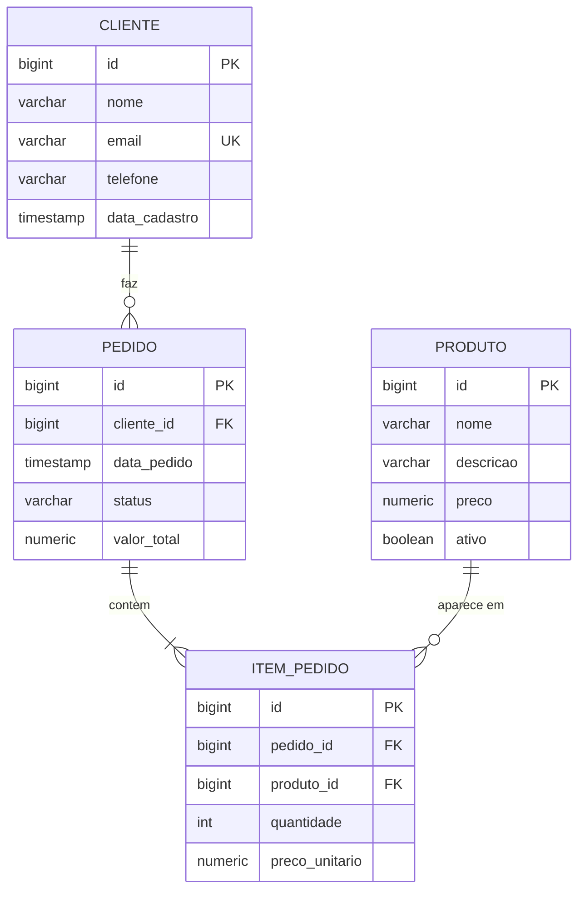

# Trabalho A2 — Otimização de Web Services

> O relatório técnico completo será escrito ao final do trabalho.

## Como executar o ambiente

### Pré-requisitos
- Java 21
- Docker com Docker Compose v2

O Maven não precisa estar instalado: o projeto usa o Maven Wrapper (`./mvnw`).

### 1. Configurar as variáveis
```bash
cp .env.example .env
```
Edite o `.env` e troque todas as senhas `troque-esta-senha`. O mesmo arquivo é lido pelo Docker Compose
e pela aplicação Spring Boot. Se as portas `5433` (PostgreSQL) ou `6379` (Redis) já estiverem em uso,
altere `POSTGRES_PORT` ou `REDIS_PORT`.

### 2. Subir o PostgreSQL e o Redis
```bash
docker compose up -d
docker compose ps        # aguarde postgres e redis ficarem "healthy"
```
As portas ficam publicadas somente em `127.0.0.1`.

### 3. Executar a API
```bash
./mvnw spring-boot:run
```

### 4. Verificar a saúde da aplicação
```bash
curl -s http://localhost:8080/actuator/health
```
O resultado esperado é `"status":"UP"`, com os componentes `db` e `redis` também `UP`.

### Recriar o banco do zero
Os scripts de `db/init/` só são executados quando o volume do PostgreSQL está vazio. Para recriar:
```bash
docker compose down -v
docker compose up -d
```

## Banco de dados e volume

### Modelo



- `pedido.status`: `PENDENTE`, `APROVADO` ou `CANCELADO`.
- `pedido.valor_total` = Σ(`quantidade` × `preco_unitario`) dos itens.
- `item_pedido.preco_unitario` guarda o preço praticado no pedido, que pode diferir do preço atual do produto.

### Scripts de inicialização (`db/init/`, executados em ordem pelo container)
| Script | Função |
|---|---|
| `01_usuario_app.sh` | Cria o usuário da aplicação, com permissão apenas de leitura e escrita de dados (sem DDL). |
| `02_schema.sql` | Cria as tabelas, as restrições e o índice `idx_item_pedido_pedido`. |
| `03_dados.sql` | Popula o banco de forma reproduzível (`setseed(0.42)`, data de referência fixa). |

### Volume gerado
| Tabela | Linhas | Tamanho total |
|---|---:|---:|
| cliente | 10.000 | 1,9 MB |
| produto | 1.000 (901 ativos) | 200 kB |
| pedido | 100.000 | 9,3 MB |
| item_pedido | 299.702 | 30 MB |

- 1 a 5 itens por pedido (média 3).
- Pedidos por cliente: mediana 9 e máximo 225 (distribuição desigual de propósito, para o experimento de índices).
- Status: ~60% aprovados, ~25% pendentes, ~15% cancelados.
- A carga leva cerca de 9 s. Os volumes podem ser ajustados nas variáveis `\set` no topo de `03_dados.sql`.

Índices existentes após a carga: as chaves primárias, `cliente.email` (UNIQUE) e `idx_item_pedido_pedido`.
Não há índice em `pedido.cliente_id` nem em `pedido.data_pedido`: essa ausência é o ponto de partida do
experimento de índices.

### Validar os dados
```bash
set -a; . ./.env; set +a
PGPASSWORD=$APP_DB_PASSWORD psql -h 127.0.0.1 -p $POSTGRES_PORT -U $APP_DB_USER -d $POSTGRES_DB \
  -f db/validacao_dados.sql > resultados/volume-dados.txt
```
O script mostra as contagens, as distribuições, as verificações de integridade (todas devem ser 0),
o checksum de reprodutibilidade e o tamanho das tabelas e dos índices. A saída da carga atual está em
[resultados/volume-dados.txt](resultados/volume-dados.txt).
